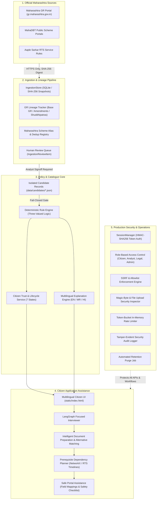

# Scheme Navigator — Technical Architecture Document

## 1. System Overview and Bounded Contexts

Scheme Navigator is structured as a modular, fail-closed platform with clean separation between policy logic, ingestion, document extraction, citizen interview, dependency planning, safe portal assistance, and production security.



---

## 2. Component Architecture

### 2.1 Domain & Evidence Models (`domain/`)
- `Scheme`: Represents a welfare or scholarship scheme. Contains `scheme_id`, `name`, `department`, `summary`, `benefits`, `required_documents`, `eligibility_rule`, `sources`, and `evidence`.
- `RuleEvidence`: Condition-level evidence record containing verbatim Marathi excerpts, cryptographic `source_document_sha256`, `official_reference`, `effective_from`, `effective_until`, and `verification_status`.
- `RuleNode`: Abstract Syntax Tree (AST) node for boolean conditions. Restricted to pure operations (`all`, `any`, `not`, `eq`, `gte`, `lte`, `in_list`, `is_null`). Excludes arbitrary code execution, dynamic eval, and non-deterministic functions.

### 2.2 Deterministic Eligibility Evaluation (`services/rule_engine.py`)
- Evaluates rules deterministically under three-valued Kleene logic:
  - `TRUE`: Condition verified met.
  - `FALSE`: Condition verified unmet.
  - `UNKNOWN`: Required profile field is missing or ambiguous.
- Fail-Closed Publication Gate:
  - Non-demo schemes with `publication_authorized=false` or `rule_status != 'active'` always return status `needs_review` and are never displayed as confirmed eligible.

### 2.3 Multilingual Explanation Engine (`services/explanation.py`)
- Transforms raw condition evaluation results into structured citizen explanations without exposing AST syntax.
- Outputs:
  1. `overall_status`: Localized high-level summary.
  2. `positive_conditions`: Verified satisfied requirements.
  3. `unmet_conditions`: Requirements not met, with actual vs required values.
  4. `missing_information`: Data needed from citizen to complete evaluation.
  5. `next_recommended_action`: Direct guidance on citizen next step.
  6. `trust_notices`: Explicit warnings that results are preliminary guidance.
- Uses static, human-reviewed translations for legal terms across English, Marathi, and Hindi.

### 2.4 Ingestion & Lineage Pipeline (`ingestion/`)
- `IngestionStore`: SQLite store tracking snapshots, byte lengths, retrieval timestamps, and SHA-256 digests.
- `ChangeDetector`: Detects remote document changes via digest comparison, triggering `DocumentChangeEvent`.
- `LineageTracker`: Models statutory legislative history:
  - Identifies Base GR (e.g., Sanjay Gandhi Niradhar GR 20 August 2019).
  - Tracks Amendments (e.g., 5 July 2023 assistance increase; 15 September 2025 disability increase).
  - Explicitly documents superseded clauses and current operative provisions.
- `DedupEngine`: Resolves scheme aliases and protects distinct statutory programmes from improper merger.

### 2.5 Citizen Trust & Verification Interface (`services/trust.py`)
- Determines one of 7 mutually exclusive verification states:
  - `DRAFT_CANDIDATE`
  - `UNDER_REVIEW`
  - `SOURCE_VERIFIED`
  - `INTERNALLY_REVIEWED`
  - `PUBLICATION_AUTHORIZED`
  - `ACTIVE`
  - `EXPIRED_OR_SUPERSEDED`
- Invariant: `is_official_government_recommendation` is strictly `False`. Inclusion of a Government Resolution reference proves citation provenance; it does not constitute official government endorsement.

### 2.6 Intelligent Document Preparation (`services/document_prep.py`)
- Matches extracted documents against scheme requirements.
- Supports officially permitted alternative documents in Maharashtra:
  - Domicile Certificate $\rightarrow$ 15-year old Ration Card, Voter ID, School Leaving Certificate showing Maharashtra birth, Birth Certificate.
  - Income Certificate $\rightarrow$ Yellow or Orange Ration Card (for Majhi Ladki Bahin).
  - Caste Certificate $\rightarrow$ Caste Validity Certificate (for professional scholarships).
- Expiry and financial year validation:
  - Rejects expired certificates where `valid_until < reference_date`.
  - Rejects income certificates where `valid_financial_year != target_financial_year`.
- Detects duplicate documents by comparing SHA-256 byte hashes and certificate numbers.
- Explains missing documents with competent issuing authority and statutory Maharashtra RTS turnaround days.

### 2.7 Prerequisite Dependency Planner (`planner/dag.py`)
- Models certificate prerequisite chains as a Directed Acyclic Graph (DAG) using NetworkX.
- Resolves dependencies topologically (e.g. Identity Proof $\rightarrow$ Domicile Certificate $\rightarrow$ Income Certificate $\rightarrow$ Scheme Application).
- Enforces cycle detection, raising `ValueError` if a circular dependency is detected.
- Injects statutory turnaround times notified under the Maharashtra Right to Public Services Act, 2015.

### 2.8 Safe Portal Application Assistance (`services/portal_assistance.py`)
- Formulates safe preparation packages for MahaDBT and Aaple Sarkar.
- Maps verified document and profile fields to portal form fields.
- Strictly classifies Aadhaar OTP, passwords, and biometric credentials as `RESTRICTED_SECURITY_FIELD` which are never collected, stored, or autofilled.
- Mandates a pre-submission safety checklist requiring citizen personal verification before application.
- Explicitly maintains `application_submission_status = "not_submitted_guidance_only"`.

### 2.9 Production Security & Operations (`security/`)
- `auth.py`: HMAC-SHA256 session token generation and session ownership binding.
- `ssrf.py`: Restricts external HTTP requests to verified HTTPS government domains (`*.maharashtra.gov.in`, `*.mahaonline.gov.in`, `*.gov.in`, `*.nic.in`), blocking private IP ranges and loopbacks.
- `upload.py`: Magic-byte file validation (`%PDF-`, PNG, JPEG, WEBP), path traversal sanitization, and rejection of executable extensions.
- `rate_limiter.py`: In-memory sliding-window request throttling with HTTP 429 response.
- `publication.py`: Cryptographic catalogue release signing by `CATALOGUE_ADMIN` with canonical SHA-256 digests and fail-closed publication enforcement.
- `audit_logger.py`: Structured JSON security event logging with PII/secret redaction.
- `retention.py`: Automatic cleanup of expired sessions and temporary files.

---

## 3. Data Flow Diagram

```text
Citizen Input / Profile
        │
        ▼
Three-Valued Rule Engine ◄── Verified Scheme Catalogue
        │
        ├──────────────────────────────┐
        ▼                              ▼
Multilingual Explanations      Trust & Status Reporter
(Satisfied / Unmet / Missing)   (7 Verification States)
        │                              │
        └──────────────┬───────────────┘
                       ▼
        Citizen Selects Candidate Scheme
                       │
                       ▼
        LangGraph Multilingual Interview
       (Targeted Missing Slot Ingestion)
                       │
                       ▼
        Document Upload & Pre-Audit
        (Magic-Byte Inspection & Gemini Vision)
                       │
                       ▼
        Intelligent Document Preparation
        (Alternative Matching, Expiry, FY, Conflicts)
                       │
                       ▼
        Prerequisite DAG Dependency Planner
        (Statutory Maharashtra RTS Act Timelines)
                       │
                       ▼
        Safe Portal Application Guidance
        (MahaDBT / Aaple Sarkar Field Mapping)
                       │
                       ▼
Citizen Reviews Checklist & Submits Directly on Government Portal
```

---

## 4. Operational & Persistence Architecture

### 4.1 SQLite Persistence & Migration Engine (`core/migrations.py`)
Scheme Navigator stores operational data across three dedicated SQLite databases in WAL (Write-Ahead Logging) mode:
1. `interviews.sqlite3`: Conversational graph checkpoints and citizen interview state.
2. `document_reviews.sqlite3`: Document extraction artifacts, page groupings, conflict findings, reviewer corrections, and audit events.
3. `ingestion.sqlite3`: Ingested snapshots, SHA-256 byte digests, change events, and analyst review queue items.

Each database maintains a `schema_migrations` tracking table (`version`, `description`, `applied_at`). The migration engine runs automatically during application startup lifespan and can be triggered on demand via `POST /admin/db/migrate`.

### 4.2 Crash-Consistent Live Backup Architecture
Backups are performed using the SQLite Online Backup API (`sqlite3.Connection.backup()`), ensuring non-blocking, crash-consistent snapshots without locking active read or write operations:
- Live backups can be generated via `POST /admin/db/backup`.
- Database restoration (`restore_database`) replaces corrupt files safely.
- Integrity verification (`check_database_integrity`) executes `PRAGMA integrity_check` on demand and on startup.

### 4.3 Concurrency Model & Single-Worker Invariant
Scheme Navigator is intentionally architected to operate with a **single worker process** (`--workers 1`):
- **Rationale:** Sliding-window rate limiting, active session token state, thread ownership locks, and review ownership bindings reside in process memory for maximum throughput and zero external infrastructure dependencies.
- **SQLite Concurrency:** SQLite in WAL mode permits concurrent readers but enforces single-writer serialization; a single-worker architecture prevents multi-process lock contention and WAL checkpoint deadlocks.
- **Horizontal Scaling Pathway:** For enterprise multi-node deployment, state storage (sessions, rate limits, review bindings) must be migrated to a distributed Redis cluster, and SQLite databases transitioned to PostgreSQL.

### 4.4 Session Ownership & Zero Cross-Citizen Leakage
- **Thread Ownership:** `_thread_owners` binds interview threads to citizen session IDs.
- **Review Ownership:** `_review_owners` binds document review records to citizen session IDs. Citizens have exclusive access to evaluate eligibility against their own review records, preventing cross-tenant snooping.
- **Reviewer Boundary:** Reviewer actions (field corrections, review completion) are strictly guarded by `require_role(UserRole.REVIEWER)`. Anonymous citizens cannot access the reviewer dashboard or modify document audit findings.

### 4.5 Air-Gapped Manual Ingestion & Differential Analysis
- **Manual Upload:** Government analysts can upload gazetted Government Resolutions (PDFs or portal HTML) via `POST /ingestion/upload-source` for air-gapped ingestion.
- **Change Detection & Diff Comparison:** `GET /ingestion/compare` computes unified text diffs and similarity metrics between successive statutory amendments to verify regulatory changes before policy rules are updated.

