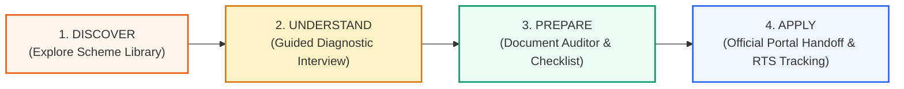
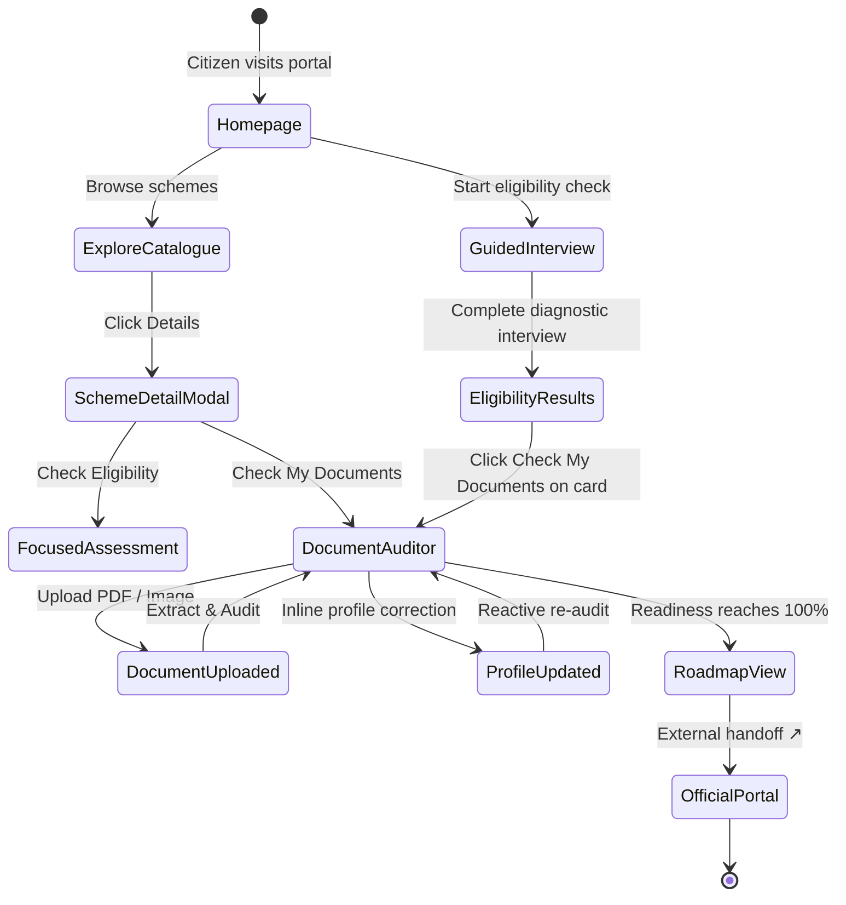

# Architecture: The Complete Citizen Journey
**Document ID:** `DOC-ARCH-CITIZEN-001`  
**Version:** 2.0.0  
**Status:** Canonical & Audited  
**Date:** 2026-11-18  
**Scope:** Complete End-to-End Maharashtra Citizen User Experience Architecture  

---

## 1. Executive Summary & Core Paradigm

The **Maharashtra Scheme Navigator** application is structured entirely around the citizen's lived journey through government welfare discovery, eligibility verification, document preparation, and official application.

Rather than presenting isolated forms or disconnected technical modules, the interface organizes all citizen actions into four cohesive pillars:

---

## 2. The Four Pillars of the Citizen Experience

### 2.1 Pillar 1: DISCOVER (`#view-explore` & `#view-home`)
- **Citizen Action:** Citizen lands on homepage, reviews platform capabilities and state statistics, and browses or searches the 75-scheme canonical library.
- **Filtering & Search:** Real-time filtering by category pills (Agriculture, Women & Child, Education, Social Justice, Industries, Health) and municipal corporation selectors (PMC, PCMC, BMC, TMC, NMMC).
- **Public Factsheets (`openSchemeFactsheet`):** Citizens can view or share official, zero-PII scheme factsheets containing Government Resolution citations, RTS timelines, and benefit schedules.

### 2.2 Pillar 2: UNDERSTAND (`#view-interview`)
- **Conversational Diagnostics:** The citizen engages with an adaptive chat agent (`InterviewerAgent`) powered by NLU classification and rule engine criteria pruning.
- **Two Modalities:**
  1. *Broad Discovery Session:* Explores all 75 schemes to recommend matching benefits.
  2. *Focused Single-Scheme Assessment:* Initiated from a specific scheme card to evaluate strictly against that scheme's substantive criteria.
- **Live Profile Drawer (`.profile-sidebar`):** Visual display of recognized demographic, financial, and geographic attributes with completion meter.

### 2.3 Pillar 3: PREPARE (`#view-documents` & `#view-prepare`)
- **Document Auditor Workspace:** Translates eligibility results into an actionable preparation checklist.
- **Upload & Local OCR Pipeline:** Handles multi-page PDFs and images with magic-byte validation, SHA-256 integrity digests, and Devanagari text extraction.
- **Actionable Findings:** Categorized plain-language feedback (Valid, Expired, Name Mismatch, Income Exceeded, Unreadable) with direct remediation triggers (`[Update Profile]`, `[Replace Document]`, `[Correct Value]`).
- **Readiness Engine:** Dynamically calculates readiness percentage and state machine status (`DOCUMENTS_PENDING`, `CORRECTIONS_REQUIRED`, `READY_FOR_APPLICATION`).

### 2.4 Pillar 4: APPLY (`#view-roadmap` & Official Portal Handoff)
- **Checklist Manifest:** Final pre-submission checklist of verified originals and copies.
- **RTS Statutory Deadlines:** Transparent notification of processing days under Maharashtra Right to Public Services Act (RTS) 2015.
- **Official Government Portal Links:** Direct, verified handoff to legitimate state platforms (`https://aaplesarkar.mahaonline.gov.in`, `https://mahadbt.maharashtra.gov.in`, PMC/PCMC portals) with non-sanctioning statutory disclaimers.

---

## 3. Technical State Machine & Citizen Transitions

---

## 4. Architectural Invariants Enforced in the Journey

1. **Reload Invariance (F5 Persistence):**
   Citizen sessions, profile attributes, active schemes, and uploaded document extractions are persisted in SQLite (`citizen_profiles.sqlite3` and `document_reviews.sqlite3`) and tied to an anonymous HMAC-SHA256 session cookie. A browser refresh restores the exact active view and computed state with 0 data loss.

2. **Trilingual Language Parity:**
   Every user-facing label, prompt, error message, and badge is mapped in Marathi (`mr`), Hindi (`hi`), and English (`en`). Mid-journey language switches update the DOM reactively with zero untranslated fallback keys or layout breakages.

3. **Statutory Authenticity Disclaimer:**
   The interface strictly maintains the invariant that local automated document analysis is an informational pre-check only. Authentic validation is exclusively performed by designated government caseworkers upon formal application submission.
