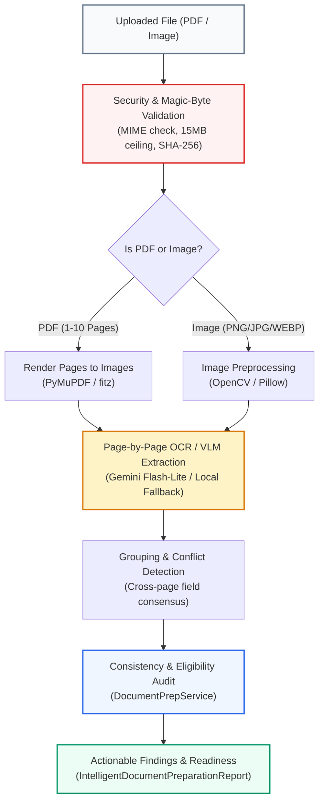

# Architecture: Document Verification & Intelligence Pipeline
**Document ID:** `DOC-ARCH-DOCVERIF-001`  
**Version:** 2.0.0  
**Status:** Canonical & Audited  
**Date:** 2026-11-18  
**Scope:** Architecture of Document Ingestion, Multi-Page PDF Handling, OCR Extraction, and Consistency Verification  

---

## 1. Executive Summary & Processing Architecture

The **Document Verification & Intelligence Pipeline** provides citizens with automated readability, completeness, and consistency pre-checks before submitting welfare applications to Government of Maharashtra portals.

---

## 2. Ingestion Security & Validation (Defense-in-Depth)

1. **Magic-Byte & MIME Validation:**
   The pipeline checks initial byte signatures (`%PDF-` for PDFs, `\x89PNG\r\n\x1a\n` for PNGs, `\xff\xd8\xff` for JPEGs, `RIFF....WEBP` for WEBP). File extensions provided in headers are never trusted in isolation.
2. **File Size & Page Limits:**
   - Single-image ceiling: 12 MiB, 20 Megapixels.
   - Multi-page PDF ceiling: 15 MiB, maximum 10 pages.
   - Password-protected or encrypted PDFs are rejected immediately with user-actionable instructions.
3. **SHA-256 Fingerprinting & Isolated Storage:**
   Every document receives a cryptographic SHA-256 hash upon receipt. Raw bytes are held in isolated session storage with strict 24-hour time-to-live (TTL) and automated hourly purge.

---

## 3. Extraction Engine: Hybrid Cloud VLM & Local Fallback

- **Primary Cloud Path (`GeminiVisionExtractor`):**
  Uses Gemini Flash-Lite for multilingual image-to-text extraction, recognizing Devanagari script, Marathi revenue terms (*दाखला*, *तहसीलदार*, *कौटुंबिक उत्पन्न*), and Latin script.
- **Local Fallback Path (`LocalFallbackDocumentExtractor`):**
  When external cloud API keys are absent or when running offline unit/browser test suites (`ENABLE_LOCAL_FALLBACK_OCR=true`), the system seamlessly falls back to local PyMuPDF text stream extraction and deterministic pattern matching without crashing or blocking the citizen journey.

---

## 4. The 9 Consistency & Verification Checks

| Check Code | Verification Objective | Detection Mechanism | Remediation Action |
| :--- | :--- | :--- | :--- |
| `PROFILE_DOCUMENT_INCOME_MISMATCH` | Reconcile declared income vs document | Document income $\ne$ profile income ($\pm 10\%$) | Prompt citizen to click `[Update My Profile to Match Document]` or `[Edit Extracted Value]` |
| `INCOME_EXCEEDS_SCHEME_THRESHOLD` | Verify scheme statutory ceiling | Extracted document income $>$ scheme limit | Flag ineligibility warning; advise alternate schemes |
| `AGE_DOB_MISMATCH` | Reconcile age / date of birth | Extracted DOB implies age $\ne$ profile age | Prompt citizen to adjust profile age or correct extracted date |
| `CASTE_CATEGORY_MISMATCH` | Verify reservation category | Extracted caste certificate category $\ne$ profile | Prompt citizen to align profile category |
| `INCOME_CERTIFICATE_EXPIRED_OR_WRONG_FY` | Verify financial year validity | Certificate FY is older than target application FY | Instruct citizen to obtain latest Tahsil income certificate |
| `DOCUMENT_FIELD_CONFLICT` | Reconcile multi-page discrepancies | Adjacent pages in multi-page PDF contain conflicting values | Flag specific conflicting pages for manual inspection |
| `UNREADABLE_LOW_CONFIDENCE` | Screen image quality | Extractor confidence $< 0.50$ or blurry text | Advise re-scanning with higher contrast or flatter angle |
| `WRONG_DOCUMENT_TYPE` | Enforce required document class | Extracted certificate title does not match requirement | Prompt citizen to upload correct document |
| `ANY_OF_GROUP_SATISFIED` | Check alternative document rules | Evaluates alternative sets (Domicile OR 15-Yr Ration Card) | Unblocks requirement group upon first valid alternative |

---

## 5. Aadhaar Privacy & Cryptographic Checksum

In accordance with Section 8A of the Aadhaar Act and DPDP Act 2023:
1. **Verhoeff $D_5$ Checksum Validation:** Any 12-digit number parsed is validated using the dihedral group $D_5$ algorithm to eliminate false-positive number sequences.
2. **Deterministic Redaction:** Valid Aadhaar numbers are immediately replaced with masked format `XXXX-XXXX-1234` in extracted JSON models, memory cache, and database records. Raw 12-digit numbers are never logged or stored.
