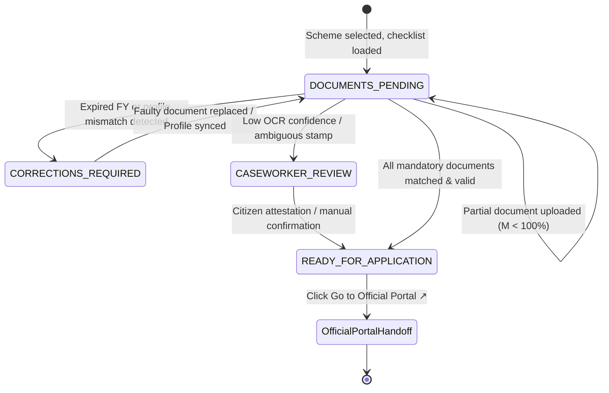

# Architecture: The Application Readiness Engine
**Document ID:** `DOC-ARCH-READINESS-001`  
**Version:** 2.0.0  
**Status:** Canonical & Audited  
**Date:** 2026-11-18  
**Scope:** Mathematical Formulation, State Machine, and Architecture of the Citizen Readiness Engine  

---

## 1. Executive Summary & Mathematical Model

The **Readiness Engine** (`ReadinessEngine` in `src/scheme_navigator/services/document_prep.py`) deterministically scores a citizen's application preparedness based on uploaded documents, statutory scheme requirements, declared citizen profile attributes, and detected conflict states.

### 1.1 Mathematical Formulation

Let $M = \{m_1, m_2, \dots, m_k\}$ be the set of mandatory statutory document requirements for target scheme $S$.  
Let $O = \{o_1, o_2, \dots, o_j\}$ be the set of optional or supporting document requirements.  
Let $C = \{c_1, c_2, \dots, c_n\}$ be the set of active conflict or mismatch findings.

Each requirement $r \in M \cup O$ evaluates to a satisfaction indicator:
$$s(r) = \begin{cases} 1 & \text{if document is verified and valid for } r \\ 0 & \text{otherwise} \end{cases}$$

The base mandatory completion ratio is:
$$\mu_M = \frac{\sum_{m \in M} s(m)}{|M|} \quad (\text{if } |M| > 0, \text{ else } 1.0)$$

The supporting optional completion ratio is:
$$\mu_O = \frac{\sum_{o \in O} s(o)}{|O|} \quad (\text{if } |O| > 0, \text{ else } 1.0)$$

The preliminary readiness score $R_{\text{raw}}$ applies statutory weighting:
$$R_{\text{raw}} = \left( 0.85 \times \mu_M + 0.15 \times \mu_O \right) \times 100$$

When all mandatory requirements are satisfied ($\mu_M = 1.0$) and zero unresolved blocking conflicts exist ($|C_{\text{blocking}}| = 0$), the readiness engine computes:
$$R = 100\%$$

If any blocking conflict exists (such as an expired financial year or income exceeding threshold), readiness is capped:
$$R \le \min(R_{\text{raw}}, 75\%) \quad \text{and status} = \text{CORRECTIONS\_REQUIRED}$$

---

## 2. State Machine Transitions

### 2.1 State Definitions

1. **`DOCUMENTS_PENDING` (Orange):**
   One or more mandatory documents have not been uploaded or recognized. The UI highlights pending items with `.state-missing` badges and provides direct upload controls.
2. **`CORRECTIONS_REQUIRED` (Red):**
   An uploaded document has failed a substantive check (e.g., certificate issued for an expired financial year, or name mismatch between document and profile). The UI presents explicit remediation guidance and one-click sync actions.
3. **`CASEWORKER_REVIEW` (Blue):**
   Document text is partially legible but OCR confidence falls below the algorithmic threshold, or the certificate requires specialized departmental verification. The citizen can inspect extracted fields, make manual edits, or attest readability.
4. **`READY_FOR_APPLICATION` (Green):**
   100% of mandatory document requirements are satisfied, zero blocking discrepancies remain, and the citizen has the complete application packet ready for government submission.

---

## 3. Reactive Re-Evaluation Triggers

The Readiness Engine recomputes the score dynamically whenever:
1. A new file is uploaded (`handleDocumentUpload`).
2. An existing document is removed or replaced (`removeUploadedDocument`, `replaceDocument`).
3. Extracted fields are corrected inline by the citizen (`saveDocumentCorrections`).
4. Citizen profile attributes are modified in the profile drawer (`syncProfileFromDocument`, `triggerEvaluationFromProfile`).
5. Target financial year is modified (e.g., transition from `2025-26` to `2026-27`).

All recalculations operate in-memory on the server in sub-millisecond time ($< 1\text{ ms}$) without requiring file re-uploads or heavy network re-ingestion.
