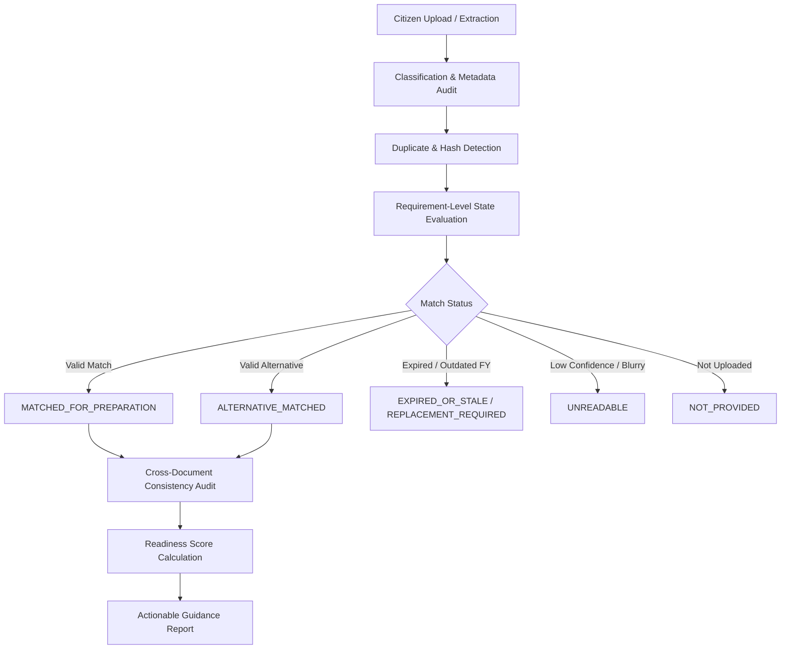

# Document Audit Workflow & Intelligent Preparation Engine
## State Machine Architecture, Classification, Extraction Verification, and Conflict Resolution

---

### 1. Document Audit Architecture

The Document Preparation Engine (`src/scheme_navigator/services/document_prep.py`) bridges raw document uploads, OCR/extraction models, and scheme statutory prerequisites into a deterministic citizen readiness evaluation:

---

### 2. The 13-State Requirement Machine

Every document requirement evaluated for a specific scheme transitions through an authoritative lifecycle state machine:

| State Key | Enum Name | Technical Trigger & Semantic Meaning | Action Required |
|---|---|---|---|
| 01 | `NOT_PROVIDED` | Mandatory or conditional requirement has no matching upload or profile evidence. | Upload required certificate or alternative document. |
| 02 | `UPLOADED` | Raw file has been received into the session upload buffer, awaiting processing. | Trigger extraction or pipeline analysis. |
| 03 | `EXTRACTION_PENDING` | Asynchronous OCR or parser job is in queue. | Wait for OCR completion. |
| 04 | `EXTRACTION_COMPLETE` | Fields parsed; awaiting scheme rule evaluation. | Automatically evaluated against scheme prerequisites. |
| 05 | `NEEDS_USER_CONFIRMATION` | Extraction yielded multiple candidate values or ambiguous parsing. | User must confirm extracted date, name, or certificate number. |
| 06 | `POSSIBLE_MATCH` | Heuristic match detected on secondary keyword or uncertified alternative. | Caseworker review or user confirmation. |
| 07 | `MATCHED_FOR_PREPARATION` | Valid document matching primary requirement with confidence >= 0.50, active validity, and correct financial year. | Ready for official submission; no further action needed. |
| 08 | `EXPIRED_OR_STALE` | Document matches required type, but `valid_until` date is in the past. | Obtain renewed certificate from competent issuing authority. |
| 09 | `UNREADABLE` | OCR confidence < 0.50 or file corrupted/unreadable. | Upload clearer, high-resolution scan or photo. |
| 10 | `INCONSISTENT_INFORMATION` | Name, age, or income on document conflicts with other verified citizen documents or interview answers. | Reconcile discrepant details or submit gazette / affidavit. |
| 11 | `MANUAL_REVIEW_REQUIRED` | Complex exemption, court order, or discretionary qualification detected. | Citizen advised to seek Talathi / Tahsildar caseworker scrutiny. |
| 12 | `REPLACEMENT_REQUIRED` | Document is structurally unsuitable (e.g. FY mismatch for single-year income certificate). | Obtain fresh certificate for the target Financial Year (e.g. FY 2026-27). |
| 13 | `NOT_REQUIRED` | Conditional requirement whose activating condition is not met (e.g. disability certificate for able-bodied applicant). | Exempt from application prerequisites. |

---

### 3. Classification & Semantic Matching Algorithm

The matching routine `_match_document_type(req_canon, doc)` handles multi-lingual variations and departmental differences without rigid string matching:

1. **Direct Enum Normalization:** Standardizes types (`income_certificate`, `domicile_certificate`, `caste_certificate`, `seven_twelve_extract`, `aadhaar_card`).
2. **Text Haystack Synthesis:** Combines OCR title evidence, document IDs, user tags, and extraction notes.
3. **Keyword Heuristics:**
   - `"income"` in requirement $\rightarrow$ matches `income_certificate` or evidence containing "income".
   - `"domicile"` or `"residence"` $\rightarrow$ matches `domicile_certificate` or evidence containing "domicile".
   - `"aadhaar"` or `"identity"` $\rightarrow$ matches `aadhaar_card` or evidence containing "aadhaar".
   - `"bank"` or `"passbook"` $\rightarrow$ matches `bank_passbook` or evidence containing "passbook".
   - `"caste"` or `"creamy"` $\rightarrow$ matches `caste_certificate` or evidence containing "caste".
   - `"7/12"` or `"land"` $\rightarrow$ matches `seven_twelve_extract`.
   - `"ration"` $\rightarrow$ matches `ration_card`.
4. **Approved Alternatives Check:** Evaluates whether uploaded document matches registered legal alternatives from `OFFICIAL_ALTERNATIVE_DOCUMENTS` (e.g., Ration card as domicile alternative).

---

### 4. Readiness Calculation & Conflict Detection

#### 4.1 Readiness Score Formula
The application readiness score represents the percentage of satisfied mandatory requirements:

$$\text{Readiness Percentage} = \text{round}\left( \frac{\text{Mandatory Satisfied}}{\text{Mandatory Total}} \times 100 \right)$$

- If `Mandatory Total == 0`, readiness defaults to 100%.
- A scheme is marked `READY_FOR_APPLICATION` strictly when $\text{Readiness Percentage} == 100\%$ and no fatal cross-document conflicts exist.

#### 4.2 Cross-Document Conflict Detection
The audit routine analyzes pairings across all extracted documents for:
1. **Name Inconsistencies:** Levenshtein or token-set distance between names extracted from Aadhaar, Domicile, and Caste certificates.
2. **Income Threshold Breaches:** Extracted annual family income exceeding scheme maximum income criteria.
3. **Financial Year Mismatches:** Single-year certificates issued for obsolete fiscal cycles.
4. **Duplicate Document Uploads:** Comparison of SHA-256 byte hashes across uploaded files. Duplicate uploads trigger automated warning findings.
