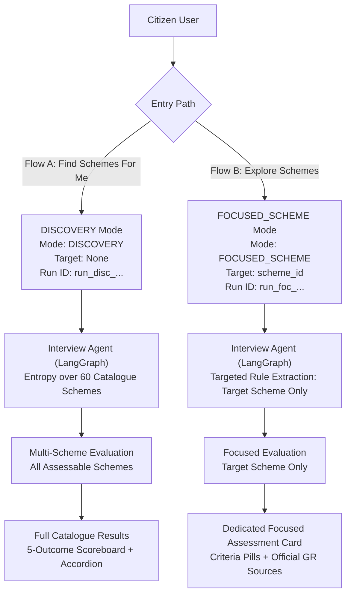

# Interview Context & Lifecycle Architecture

## 1. Architectural Overview

The Maharashtra Scheme Navigator provides two distinct citizen entry paths that require context-isolated execution:



---

## 2. Context Model & Domain Schemas

In `src/scheme_navigator/domain/models.py`:

```python
class InterviewMode(StrEnum):
    DISCOVERY = "DISCOVERY"
    FOCUSED_SCHEME = "FOCUSED_SCHEME"

class InterviewRunContext(BaseModel):
    interview_run_id: str = Field(min_length=1, max_length=200)
    mode: InterviewMode = InterviewMode.DISCOVERY
    target_scheme_id: str | None = Field(default=None, max_length=80)
    citizen_profile_id: str | None = None
    catalogue_version: str = "2026.11"
    rule_version: str = "1.0.0"
    language: Language = Language.EN
    status: Literal["active", "completed", "abandoned"] = "active"
    created_at: datetime = Field(default_factory=lambda: datetime.now(timezone.utc))
    completed_at: datetime | None = None
```

In `InterviewStart`:
- `mode`: `InterviewMode | None` (defaults to `DISCOVERY`)
- `target_scheme_id`: `str | None` (validated against canonical catalogue)
- `scope`: `str = "canonical"`

---

## 3. Database Schema & Migration Specification

In `src/scheme_navigator/core/migrations.py`:

**Migration Version 2 (`CITIZEN_PROFILE_MIGRATIONS`):**
```sql
ALTER TABLE interview_runs ADD COLUMN mode TEXT DEFAULT 'DISCOVERY';
ALTER TABLE interview_runs ADD COLUMN target_scheme_id TEXT;
ALTER TABLE interview_runs ADD COLUMN catalogue_version TEXT DEFAULT '2026.11';
ALTER TABLE interview_runs ADD COLUMN rule_version TEXT DEFAULT '1.0.0';
ALTER TABLE interview_runs ADD COLUMN language TEXT DEFAULT 'en';
ALTER TABLE interview_runs ADD COLUMN completed_at TIMESTAMP;
ALTER TABLE interview_runs ADD COLUMN results_json TEXT;
```

This guarantees persistence of the complete run context and isolates evaluation results with their respective execution run.

---

## 4. Lifecycle Transitions & State Isolation

### Flow A: Discovery Journey (`DISCOVERY`)
1. Citizen triggers `startFindSchemesJourney()`.
2. Client state initializes:
   - `state.interviewMode = 'DISCOVERY'`
   - `state.targetSchemeId = null`
   - `state.selectedSchemeId = null`
   - `state.runResults = null`
   - `state.threadId = 'run_disc_' + uuid`
3. Backend records run context with `mode='DISCOVERY'`.
4. Agent asks adaptive questions based on Shannon entropy information gain across candidate schemes.
5. On completion, backend evaluates all assessable schemes, persists results in `interview_runs.results_json`, and sets `completed_at`.
6. Client displays `.scoreboard` with 5 outcome counts and renders all evaluated cards.

### Flow B: Focused Scheme Assessment (`FOCUSED_SCHEME`)
1. Citizen selects scheme in Explore or Modal and clicks *Check Eligibility*.
2. Client triggers `startFocusedAssessment(schemeId)`:
   - `state.interviewMode = 'FOCUSED_SCHEME'`
   - `state.targetSchemeId = schemeId`
   - `state.selectedSchemeId = schemeId`
   - `state.runResults = null`
   - `state.threadId = 'run_foc_' + uuid`
3. Backend validates `target_scheme_id` against canonical catalogue (404 on invalid scheme) and records run context.
4. Agent restricts candidate schemes strictly to `[target_scheme_id]`, skipping all unrelated criteria.
5. On completion, backend evaluates strictly `target_scheme_id`, persists results in `interview_runs.results_json`, and sets `completed_at`.
6. Client hides `.scoreboard` and `#not-eligible-accordion`, rendering a dedicated focused result card.

---

## 5. Security & Tenant Isolation Invariants

1. **Authorization**: Every request verifies `UserSession` ownership via `session_manager.authorize_thread_access(session, thread_id)`. Cross-tenant result fetches return HTTP 403.
2. **Idempotency**: Runs cannot be contaminated by late-arriving asynchronous responses from earlier sessions because each run carries an immutable unique run ID.
3. **Fail-Closed Catalogue Validation**: If a citizen requests an unapproved or nonexistent scheme ID, the backend immediately halts with HTTP 404 rather than silently defaulting to an arbitrary scheme.
