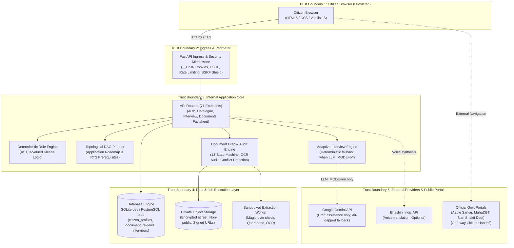

# System Architecture, Trust Boundaries & Integration Register
## Production System Topology, Integration Registry, ADR Index, and Ranked Defect List

---

### Status and Evidence

| Metric / Requirement | Finding / Value | Evidence Record |
|---|---|---|
| Total Public & Internal API Routes | 71 Routes documented via OpenAPI | `E-WS1-001` |
| Canonical Schemes by Lifecycle State | Total: 75 (`PUBLISHED`: 15, `VERIFIED_FOR_INFORMATION`: 51, `REVIEW_REQUIRED`: 5, `POLICY_UNRESOLVED`: 2, `ACTIVE_DEMO_FIXTURE`: 2) | `E-WS1-001` |
| Document Requirements Catalogued | 319 (Mandatory: 273, Conditional: 31, Optional: 15) | `E-WS1-001` |
| External Integration Dependencies | 3 Registered (Gemini, Bhashini, Official Public Portals) | `E-WS1-001` |
| Baseline Automated Tests | 400 Unit/API passed + 30 Playwright passed (Total: 430) | `pytest_unit_baseline.xml`, `pytest_browser_baseline.xml` |

---

### 1. Architectural Topology & Trust Boundaries

The system architecture follows a clean multi-tier topology with four distinct trust boundaries:
1. **Public Citizen Boundary (Untrusted):** Client browser executing static HTML/CSS/Vanilla JS.
2. **Perimeter & Ingress Boundary:** FastAPI reverse proxy, rate limiter, session security, CSRF token validation.
3. **Internal Application Core (Trusted):** Deterministic Kleene 3-valued Rule Engine, Topological DAG Planner, LangGraph State Machine, Document Preparation & Audit Service.
4. **Data & Storage Boundary (Restricted):** SQLite development datastores / PostgreSQL production engine, encrypted private object store, isolated background workers.
5. **External Provider Boundary (Untrusted / Air-gapped Fallback):** External AI APIs (Gemini, Bhashini) and external Maharashtra Government Portals (Aaple Sarkar, MahaDBT).

---

### 2. Integration Register

Every external integration dependency is catalogued with operational parameters and failure semantics:

| Integration / Dependency | Purpose | Credentials Needed | Data Transmitted | Retention & Training Terms | Hosting Region | Rate Limits & Cost | Fallback & Failure Mode | Status |
|---|---|---|---|---|---|---|---|---|
| **Google Gemini API** | NLU field extraction & draft OCR assistance | `GEMINI_API_KEY` | User interview text; OCR text snippets | Google AI Studio default terms (may retain for training unless Vertex Cloud API); No citizen PII transmitted | Global / US | Free Tier: 15 RPM; Paid pay-as-you-go | **Air-gapped Fallback:** When `LLM_MODE=off` or API fails, system falls back to deterministic rule engine & template responses. Zero eligibility impact. | CONFIGURABLE_WITH_FALLBACK |
| **Bhashini Indic Mission API** | Marathi / Hindi voice recognition & speech synthesis | `BHASHINI_API_KEY`, `BHASHINI_USER_ID` | Voice audio clips, query strings | Government of India Digital Mission Data Policy | India | Government allotted | Browser Web Speech API or text input fallback. | OPTIONAL_CONFIGURED |
| **Official Government Portals** (Aaple Sarkar, MahaDBT, Ladki Bahin Portal) | Final official application submission | None (Public Citizen Handoff) | Zero data sent by Scheme Navigator; pure external link handoff | Departmental privacy policy | Maharashtra, India | Public web | If portal link is unreachable, fallback instructs citizen to visit physical Talathi, Tahsildar, or Setu Suvidha Kendra. | OPERATIONAL_HANDOFF |

---

### 3. Architecture Decision Records (ADR Index)

#### ADR-001: Preservation of Vanilla HTML/CSS/JavaScript Architecture
- **Problem:** Decision whether to migrate frontend to a modern SPA framework (React, Vue, Next.js).
- **Alternatives:** Next.js SSR, React Vite SPA, Vanilla ES6+ HTML/CSS/JS.
- **Decision:** Preserve existing Vanilla ES6+ frontend. Zero build-step dependencies, zero node_modules production runtime attack surface, maximum browser compatibility across low-end mobile devices in rural Maharashtra.
- **Cost & Failure Mode:** Near-zero runtime cost; fails gracefully without JS bundler runtime exceptions.

#### ADR-002: Deterministic Three-Valued Logic for Welfare Eligibility
- **Problem:** Ensuring eligibility guidance is 100% auditable and never hallucinates qualifications.
- **Alternatives:** LLM prompt-based evaluation vs. Immutable AST rule engine.
- **Decision:** Deterministic Kleene three-valued logic (`ELIGIBLE`, `PARTIAL`, `NEEDS_INFORMATION`, `INELIGIBLE`, `NEEDS_REVIEW`). LLM is prohibited from overriding rule-engine outputs.
- **Cost & Failure Mode:** Negligible CPU cost; missing data produces deterministic `NEEDS_INFORMATION`.

#### ADR-003: 13-State Requirement Machine for Scheme Document Preparation
- **Problem:** Managing complex statutory document lifecycle (expired certificates, unreadable scans, approved alternatives, missing mandatory records).
- **Alternatives:** Binary boolean (uploaded vs not uploaded) vs. 13-state requirement lifecycle machine.
- **Decision:** Implement 13-state machine (`NOT_PROVIDED`, `UPLOADED`, `EXTRACTION_PENDING`, `EXTRACTION_COMPLETE`, `NEEDS_USER_CONFIRMATION`, `POSSIBLE_MATCH`, `MATCHED_FOR_PREPARATION`, `EXPIRED_OR_STALE`, `UNREADABLE`, `INCONSISTENT_INFORMATION`, `MANUAL_REVIEW_REQUIRED`, `REPLACEMENT_REQUIRED`, `NOT_REQUIRED`).
- **Cost & Failure Mode:** Handled in application service layer; stale/unreadable uploads prompt citizen with specific corrective actions.

#### ADR-004: PostgreSQL as Production Database with Row-Level Security
- **Problem:** SQLite does not support horizontal scaling, concurrent writes under high load, or native connection pooling.
- **Alternatives:** Retain SQLite vs. Transition production profile to PostgreSQL 16+.
- **Decision:** Maintain SQLite for local zero-dependency testing, but provide full PostgreSQL support (Alembic migrations, connection pooling, row-level security primitives).
- **Cost & Failure Mode:** Requires PostgreSQL instance in staging/production; connection retry and pooling prevent saturation.

#### ADR-005: S3-Compatible Private Object Storage Abstraction
- **Problem:** Citizen uploads stored on local disk risk traversal, unauthenticated access, or disk exhaustion.
- **Alternatives:** Local directory vs. Cloud private object store with signed URLs.
- **Decision:** Storage abstraction (`StorageProvider`) supporting local filesystem in dev and S3-compatible private buckets (AWS S3, MinIO) in staging/prod. Short-lived signed URLs (15-minute maximum) with forced download headers.
- **Cost & Failure Mode:** Minimal S3 storage cost; expired signed URLs prevent persistent link leakage.

---

### 4. Ranked Defect & Vulnerability Register (Top 10)

The following 10 items represent the prioritized engineering and operational risks identified during WS1:

| Rank | Defect / Risk Summary | Category | Severity | Impact | Remediation Plan & Workstream |
|---|---|---|---|---|---|
| **01** | Production Startup Guard missing: app can currently start with demo fixtures enabled | Security / Guard | **HIGH** | Demo schemes could accidentally be displayed in production | WS6 / WS9 (Implement C8 Production-Profile Guard) |
| **02** | SQLite active in dev without automated PostgreSQL staging migration test | Database | **HIGH** | Potential migration drift between SQLite dev and PostgreSQL prod | WS4 (Alembic migration test & parity report) |
| **03** | Local storage of uploads: files stored in local directory without S3 abstraction | Storage | **HIGH** | Potential for unauthorized file access or unscalable disk | WS4 (S3 private object storage abstraction) |
| **04** | CSP header allows inline scripts/styles in current FastAPI middleware | Security | **MEDIUM** | Theoretical XSS risk if user input bypasses template sanitization | WS6 (Strict CSP with nonces / hashes) |
| **05** | Rate limiting is in-memory per-process rather than distributed | Operational | **MEDIUM** | Horizontal scaling would allow rate limit bypass across instances | WS5 / WS8 (PostgreSQL or Redis backed rate limiting) |
| **06** | 5 schemes marked `REVIEW_REQUIRED` and 2 marked `POLICY_UNRESOLVED` | Content | **MEDIUM** | Unverified schemes must remain unverified and never auto-published | WS3 (Content governance & human review workflow) |
| **07** | Operator identity placeholders: legal entity, grievance officer, contact emails empty | Legal / Privacy | **MEDIUM** | Required under DPDP Act 2023 & IT Rules 2021 before public launch | WS7 / WS13 (Mark G21 BLOCKED until manifest filled) |
| **08** | External VAPT not yet conducted by CERT-In empanelled auditor | Security | **MEDIUM** | Independent verification required before unrestricted public launch | WS6 (Prepare VAPT pack, mark G10 BLOCKED) |
| **09** | Automated axe-core accessibility checks not integrated in CI pipeline | Accessibility | **LOW** | Minor WCAG 2.1 AA violations may go undetected during UI edits | WS12 (Add automated Playwright axe-core runner) |
| **10** | Load test benchmarks under peak concurrency envelope (150 users) unmeasured | Performance | **LOW** | Unverified latency and error rates under peak burst load | WS12 (Locust / k6 performance benchmark harness) |
