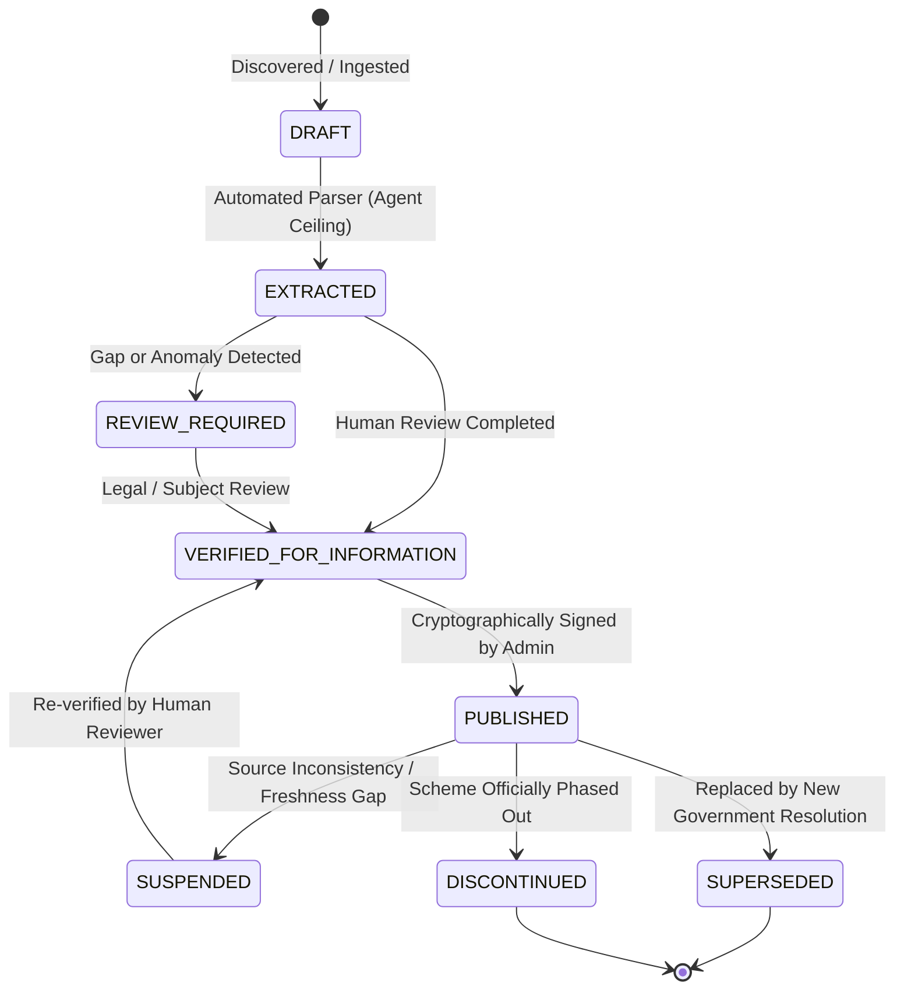

# Maharashtra Scheme Navigator — Content Governance & Scheme Truth Manual
## Protocol B3 · Primary-Source Grounding, Content Lifecycle, and Citizen Feedback Loop

---

## 1. Executive Summary & Statutory Purpose

Maharashtra Scheme Navigator (MSN) provides informational assistance and document preparation guidance to citizens seeking social welfare benefits across the State of Maharashtra. Because citizens rely on this guidance to make administrative decisions, content governance is governed by non-negotiable legal and engineering constraints:

1. **Protocol B3 (Agent Ceiling Invariant):** The automated agent's ceiling for government content is `EXTRACTED`. Automated processes, AI pipelines, and coding agents may never mark content `VERIFIED_FOR_INFORMATION` or `PUBLISHED`. Human review by a designated legal or departmental reviewer cannot be simulated.
2. **Primary-Source Grounding:** No scheme record exists without traceable citation to an official Government Resolution (GR), Gazette Notification, or verified Departmental portal URL.
3. **Demo Fixture Segregation:** Demo fixtures (such as `ACTIVE_DEMO_FIXTURE`) exist solely for offline deterministic testing and must be isolated and suppressed in production runtime environments (`APP_ENV=production`).

---

## 2. Scheme Content Lifecycle State Machine



### Lifecycle State Definitions

| State | Allowed Origin | Public Visibility | Evaluation Engine |
|---|---|---|---|
| `DRAFT` | Automated crawler / Ingestion | Hidden | Excluded |
| `EXTRACTED` | Automated extractor (Agent ceiling) | Reviewer UI only | Excluded |
| `REVIEW_REQUIRED` | Ingestion flags conflicting sources | Reviewer UI only | Excluded |
| `POLICY_UNRESOLVED` | Statutory conflict or ambiguity | Reviewer UI with alert | Excluded |
| `VERIFIED_FOR_INFORMATION` | Designated Human Reviewer | Public (Notice: Information only) | Explanatory only |
| `PUBLISHED` | Catalogue Admin with Release Key | Public (Production Catalogue) | Active Evaluation |
| `ACTIVE_DEMO_FIXTURE` | Seed fixtures for automated test suites | Local / Staging test only | Demo evaluation only (Excluded in prod) |
| `SUSPENDED` | Freshness monitor / citizen report | Public (Marked as temporarily suspended) | Blocked |
| `SUPERSEDED` | Newer GR published | Public (Redirects to newer scheme) | Archived |

---

## 3. Source Citation and Grounding Standards

Every scheme in the canonical catalogue must record:
1. **Source Kind:** One of `government_resolution`, `official_gazette`, `departmental_guideline`, `authorized_portal`.
2. **Issuing Authority:** Full departmental hierarchy (e.g., *Social Justice and Special Assistance Department, Government of Maharashtra*).
3. **Statutory Reference:** Official GR code or Gazette Notification number (e.g., *शासन निर्णय क्रमांक: संगनियो-२०२४/प्र.क्र.४५/योजना-१*).
4. **Official Source URL:** Validated through `src/scheme_navigator/security/ssrf.py` ensuring HTTPS protocol, restriction to `.maharashtra.gov.in` / `.gov.in` / `.nic.in`, and zero connection to private IP ranges.
5. **Evidence Excerpt & Hash:** Verbatim statutory excerpt with its SHA-256 cryptographic digest.

---

## 4. Demo Data Segregation & Production Safeguards

- When `APP_ENV=production` or `APP_ENV=prod`:
  - `settings.demo_fixtures_enabled` evaluates to `False`.
  - `SchemeCatalog.for_runtime(demo_fixtures_enabled=False)` omits `data/demo/schemes.json`.
  - The C8 Startup Guard aborts startup if demo fixtures are inadvertently enabled in a production profile.
  - Demo fixtures are strictly flagged `publication_authorized: False`.

---

## 5. Citizen Feedback Loop and Issue Reporting (`POST /trust/report-issue`)

Citizens encountering outdated eligibility criteria, broken departmental links, or discrepancies between Navigator guidance and official portal guidelines can submit an issue report directly.

### Endpoint Specification
- **Path:** `POST /trust/report-issue`
- **Rate Limit:** 10 requests per 60 seconds per IP
- **Payload Schema:**
  ```json
  {
    "scheme_id": "candidate-majhi-ladki-bahin",
    "issue_type": "outdated_info",
    "description": "GR amended income threshold to include joint family exceptions.",
    "citizen_contact": "optional@contact.in",
    "language": "mr"
  }
  ```
- **Response Schema:**
  ```json
  {
    "ticket_id": "TICKET-7A9B3E2F10",
    "scheme_id": "candidate-majhi-ladki-bahin",
    "status": "RECEIVED",
    "received_at_iso": "2026-11-17T17:05:00Z",
    "message": "तुमचा अभिप्राय यशस्वीरीत्या नोंदवला गेला आहे..."
  }
  ```

### Remediation Workflow & SLA
1. **Ticket Creation:** Append-only log in `data/citizen_reports.jsonl` and structured `CITIZEN_REPORT_SUBMITTED` event in `data/security_audit.log`.
2. **Review Triage:** Content governance team triages within 48 business hours.
3. **Verification:** Inconsistencies verified against Mantralaya GR portal (`https://gr.maharashtra.gov.in`).
4. **Action:** If verified, scheme status updated to `REVIEW_REQUIRED` or updated GR ingested into `data/candidates/` for human approval.
