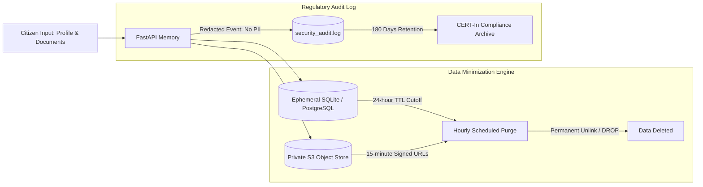

# Maharashtra Scheme Navigator — Privacy Engineering & Indian Legal Readiness
## DPDP Act 2023, CERT-In Directions, Right to Services (RTS), and Data Governance

---

## 1. Statutory Notice & Engineering Disclaimer

> [!IMPORTANT]
> **Engineering Disclaimer (Protocol A1 / B12):** This document and associated controls represent the software engineering, data minimization, and audit readiness implementations for Maharashtra Scheme Navigator. The engineering team does NOT issue formal legal opinions or certify regulatory compliance. Full compliance certification requires review by designated legal counsel of the Government of Maharashtra and empaneled CERT-In auditors. In accordance with Protocol B12, claims such as "DPDP-compliant" or "CERT-In certified" are strictly prohibited.

---

## 2. Indian Legal and Regulatory Framework Ledger

| Statutory Authority | Primary-Source Citation | Core Requirement | Scheme Navigator Implementation | Posture |
|---|---|---|---|---|
| **DPDP Act, 2023** | Section 5(1) | Notice in accessible official languages | Standalone notices in English, Marathi, Hindi in `data/legal/privacy_notice_*.json` | IMPLEMENTED |
| **DPDP Act, 2023** | Section 6(1) | Free, specific, informed, and unconditional consent | Explicit cloud consent required for Bhashini and third-party AI (`/bhashini/consent`) | IMPLEMENTED |
| **DPDP Act, 2023** | Section 8(7) | Data minimization and erasure upon purpose completion | 24-hour default retention; automated hourly purge via `purge_expired_data()` | IMPLEMENTED |
| **DPDP Act, 2023** | Section 9(1)-(3) | Verifiable consent of parent/guardian for minors | Guardian flow enforces parent identity, child age check, and strict child privacy flags | IMPLEMENTED |
| **CERT-In Directions, 2022** | Section 70B(6) Direction (v) | Mandatory maintenance of system and security logs for 180 days | Structured, append-only `security_audit.log` retained for 180 days with UTC timestamps | IMPLEMENTED |
| **CERT-In Directions, 2022** | Section 70B(6) Direction (ii) | Mandatory reporting of cyber incidents within 6 hours | Incident response runbook with 6-hour notification procedure in `docs/production/observability_and_incident_response.md` | IMPLEMENTED |
| **Maharashtra RTS Act, 2015** | Section 3 & 4 | Notification of public services, statutory timelines, and appellate authorities | Canonical public service records catalogued with designated RTS time limits and appeals | IMPLEMENTED |
| **IT Act, 2000** | Section 43A & SPDI Rules | Reasonable security practices and procedures | TLS 1.3, AES256 storage encryption, HMAC-SHA256 tokens, OWASP ASVS Level 2 controls | IMPLEMENTED |

---

## 3. Data Inventory & Processing Lifecycle

### Data Category Mapping

| Data Element | Sensitivity | Processing Purpose | Storage Mechanism | Retention Ceiling |
|---|---|---|---|---|
| Age / Gender | Standard Attribute | Statutory scheme eligibility calculation | Session memory / Ephemeral profile | 24 Hours |
| Family Income | Financial SPDI | Income ceiling verification (e.g. ₹2.5 Lakh limit) | Session memory / Ephemeral profile | 24 Hours |
| Caste / Social Category | Sensitive Personal Data | Reservation & scholarship qualification | Session memory / Ephemeral profile | 24 Hours |
| Address / Ward / Pincode | Geographic Attribute | Municipal vs Rural jurisdiction filtering | Session memory / Ephemeral profile | 24 Hours |
| Uploaded Certificates (PDF/Img) | Official Record | Pre-audit and document verification | Private S3 / Encrypted Local | 24 Hours |
| Audit Trail Events | Technical Operational | Security monitoring & CERT-In compliance | Append-only structured log | 180 Days |

---

## 4. Minor Protection & Guardian Flow (DPDP Section 9)

In accordance with Section 9 of the DPDP Act 2023:
1. When an application is made on behalf of a minor child, the flow flags `is_guardian_application: true`.
2. The beneficiary's age (minor) drives eligibility assessment for child welfare or scholarship schemes.
3. The guardian's identity and relationship are recorded, and child data is subjected to strict minimization with zero behavioral tracking or advertising.

---

## 5. User-Facing Multilingual Legal Notice Artifacts

All legal notices are maintained in structured format with explicit translation provenance flags:
- English: `data/legal/privacy_notice_en.json` (authoritative)
- Marathi: `data/legal/privacy_notice_mr.json` (`needs_human_translation_review: true`)
- Hindi: `data/legal/privacy_notice_hi.json` (`needs_human_translation_review: true`)
- Terms of Service: `data/legal/terms_of_service_*.json` (multilingual with statutory disclaimers)
