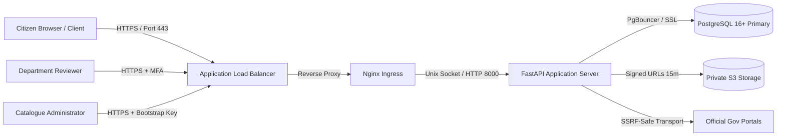

# VAPT Readiness Pack — Architecture and Data Flow
## Maharashtra Scheme Navigator (MSN)

---

## 1. High-Level Component Topology

---

## 2. Key Data Flows & Trust Boundaries

### Data Flow 1: Anonymous Citizen Interview (Journey A & B)
1. Citizen accesses web interface; frontend requests `POST /auth/session`.
2. Backend generates cryptographically signed HMAC token and issues HttpOnly cookie.
3. Citizen submits answers (`POST /interview/answer`); thread is bound to citizen session ID.
4. Deterministic rule engine evaluates eligibility without external network calls.
5. Interview state expires after 24 hours and is purged by hourly retention worker.

### Data Flow 2: Document Upload & Pre-Audit (Journey C)
1. Citizen uploads proof of eligibility (`POST /documents/audit-upload`).
2. Magic-byte security validator inspects payload (`%PDF-`, `\x89PNG`, `\xff\xd8\xff`).
3. If valid, payload stored in private S3 bucket with AES256 encryption.
4. Presigned URLs issued exclusively with 15-minute maximum TTL.
5. Uploaded documents purged automatically after retention period.

### Data Flow 3: Content Ingestion & Human Approval (Journey D)
1. Automated crawler fetches government resolutions via `SSRFSafeTransport`.
2. Extractor generates candidate scheme with publication status strictly capped at `EXTRACTED` (Protocol B3).
3. Human legal reviewer logs in with privileged session and approves scheme (`VERIFIED_FOR_INFORMATION`).
4. Catalogue administrator signs release with cryptographic key (`PUBLISHED`).
