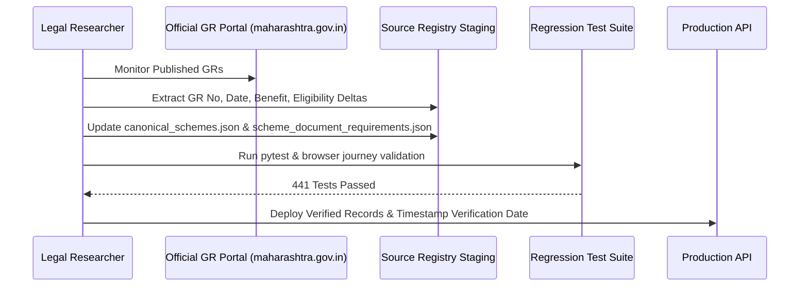

# Scheme Information Maintenance & Freshness Governance
## Reviewer Workflows, Statutory Update Protocols, and Coverage Telemetry

---

### 1. Maintenance & Reviewer Philosophy

Government welfare rules, income thresholds, and application channels in Maharashtra undergo periodic revision through Departmental Government Resolutions (शासन निर्णय). To ensure that citizen advice remains statutory, truthful, and fresh, Scheme Navigator employs a closed-loop governance framework:

1. **Source Freshness Threshold:** Every scheme record has a `last_source_verification_date`. Schemes unverified for >90 days trigger visual freshness warnings (`freshness-warn-pill`).
2. **Reviewer UI & Approval Queue:** Caseworkers and legal researchers inspect updated GRs via the Reviewer Interface (`/reviewer` and `src/scheme_navigator/api/reviewer_ui.py`).
3. **Audit Trail & Immutability:** Changes to scheme eligibility rules or document requirements are recorded with GR reference, timestamp, and reviewer ID.

---

### 2. Reviewer Coverage & Administrative Telemetry API

The endpoint `GET /admin/scheme-coverage` exposes real-time verification coverage across all catalogued welfare programs:

#### Request
`GET /admin/scheme-coverage`

#### Response Payload Schema
```json
{
  "total_canonical_schemes": 75,
  "verified_schemes": 51,
  "schemes_with_detailed_document_requirements": 75,
  "jurisdiction_breakdown": {
    "MAHARASHTRA_STATE": 48,
    "CENTRAL": 17,
    "MUNICIPAL_CORPORATION": 10
  },
  "all_75_schemes_covered": true,
  "coverage_percentage": 100
}
```

This endpoint allows monitoring dashboards to assert that zero schemes are orphaned or missing document requirements.

---

### 3. Statutory Update Workflow

When a new Government Resolution is issued (e.g., expanding Ladki Bahin income criteria or revising MJPJAY hospital procedures):



---

### 4. Reviewer UI Operations

The Reviewer Portal (`/reviewer`) enables government officers and caseworkers to:
1. **Audit Citizen Application Submissions:** Review flagged documents, unreadable certificates, and marginal eligibility determinations.
2. **Override Discrepancies with Notes:** Record official justification (e.g., applicant provided Gazette Notification for surname discrepancy).
3. **Export Statutory Factsheets:** Generate unbranded, citizen-safe PDF factsheets containing verified criteria and official portal links for public distribution at Gram Panchayat / Setu Kendra counters.
