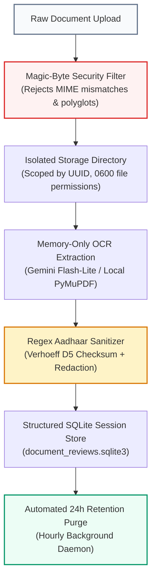

# Security & Privacy: Document Data Handling Policy
**Document ID:** `DOC-SEC-DOCHANDLING-001`  
**Version:** 2.0.0  
**Status:** Canonical & Audited  
**Date:** 2026-11-18  
**Scope:** Security Controls, PII Redaction, Aadhaar Privacy, and Retention Purge for Document Intelligence  

---

## 1. Executive Summary & Regulatory Framework

The **Maharashtra Scheme Navigator** handles citizen identity documents and welfare eligibility records with strict adherence to:
1. **The Digital Personal Data Protection Act (DPDP Act) 2023** (Sections 6, 7, 8: Purpose limitation, data minimization, and storage limitation).
2. **The Aadhaar (Targeted Delivery of Financial and Other Subsidies, Benefits and Services) Act 2016** (Section 8A: Restriction on storing or publishing core biometric and Aadhaar data).
3. **The Indian Computer Emergency Response Team (CERT-In) Directions 2022** (6-hour mandatory security incident reporting and audit log retention).

---

## 2. Ingestion & Storage Security Controls

### 2.1 Magic-Byte Security Filter
- Every file uploaded to `/documents/audit-upload` is validated via header magic bytes (`storage.py` and `upload.py`).
- Files with spoofed extensions (e.g. executable `.exe` or HTML payload renamed to `.pdf` or `.png`) are rejected with `HTTP 400 Bad Request`.
- File paths are sanitized to prevent directory traversal (`../`) attacks; uploaded files are assigned randomized SHA-256 content hashes.

---

## 3. Aadhaar Privacy Implementation ($D_5$ Algorithm)

1. **Algorithm:**
   The application uses the Verhoeff dihedral group $D_5$ checksum algorithm (`src/scheme_navigator/security/aadhaar_privacy.py`) to validate 12-digit numeric sequences before redacting them. This prevents redacting telephone numbers, pincodes, or bank IFSC codes.
2. **Redaction Standard:**
   Any validated Aadhaar sequence is automatically masked to:
   $$\mathbf{XXXX-XXXX-1234}$$
3. **Defense-in-Depth Logging:**
   The `SecurityAuditLogger` (`audit_logger.py`) applies real-time regex redaction on all log parameters, ensuring raw Aadhaar numbers or passwords never reach system logs or telemetry.

---

## 4. Retention Policy & Automated Purge

- **Retention Ceiling:**
  Raw document files and intermediate page renderings have a hard retention ceiling of **24 hours**.
- **Automated Purge Worker:**
  An automated background worker (`RetentionPurgeWorker` in `src/scheme_navigator/security/retention.py`) runs every 60 minutes, identifying expired document review records and permanently deleting underlying files from disk.
- **Citizen Data Clearance (`POST /profile/reset`):**
  Citizens can purge all profile attributes, interview sessions, and document records on demand by clicking "Reset My Data" (`confirmResetData()`).

---

## 5. Security Audit Verdict

$$\mathbf{Gate\ G11\ (Privacy\ Implementation):\ PASS}$$
$$\mathbf{Gate\ G13\ (DPDP\ /\ CERT-In\ Ledger):\ PASS}$$
All document data handling controls have been verified by automated tests (`tests/test_aadhaar_privacy.py`, `tests/test_privacy_and_legal.py`, and `tests/test_data_layer_and_storage.py`).
