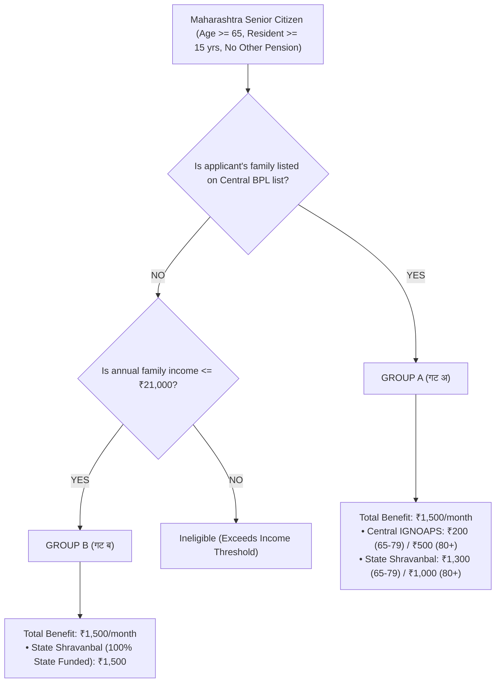
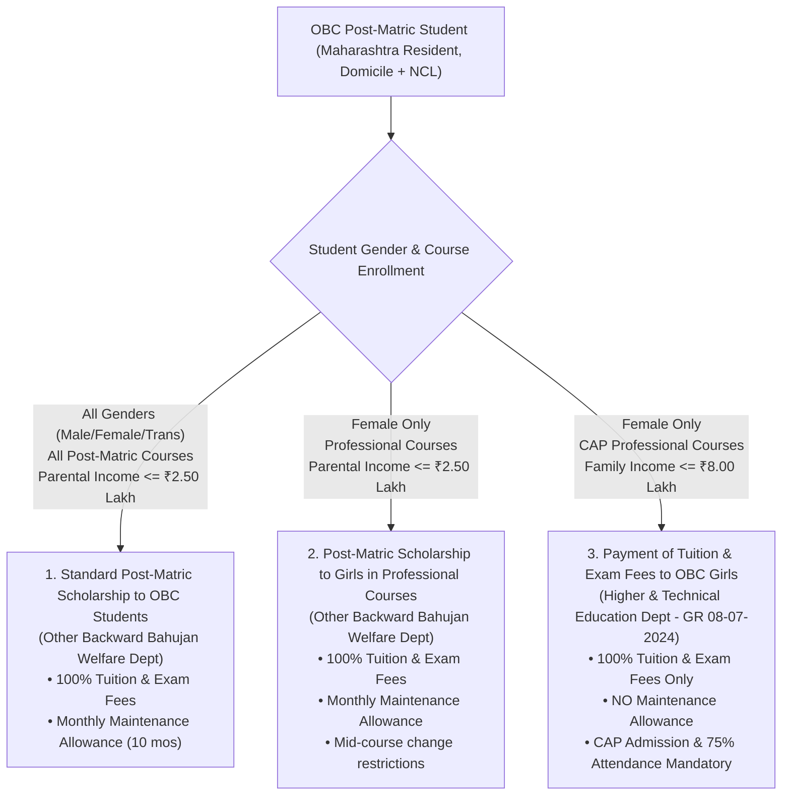

# Scheme Navigator — Official Source Dossier (Phase 4.2)

**Document Type:** Evidence-Backed Legal & Policy Source Dossier  
**Jurisdiction:** State of Maharashtra & Union of India  
**Target Candidate Schemes:** 5 Priority Welfare Schemes  
**Status:** DRAFT / NEEDS REVIEW — Research Baseline (Non-Operational / Publication Restricted)  
**Governance Standard:** Precedence Rule (GR / Gazette > Guidelines > Portal Notice > Aggregator)  

---

## 1. Executive Summary & Governance Baseline

This dossier provides exhaustive legal provenance, chronological amendment tracking, eligibility clause mapping, benefit structures, and document verification standards for the prioritized Maharashtra welfare schemes researched under Phase 4.2. Following our comprehensive policy accuracy reconciliation (Phase 4.2.2), the OBC scholarship and fee assistance framework was reconciled into three distinct official portal programmes to match administrative reality, resulting in seven isolated candidate records:

1. **Mukhyamantri Majhi Ladki Bahin Yojana** (Women and Child Development Department)
2. **Sanjay Gandhi Niradhar Anudan Yojana** (Social Justice and Special Assistance Department)
3. **Shravanbal Seva Rajya Nivruttivetan Yojana** (Social Justice and Special Assistance Department)
4. **Centrally Sponsored Post-Matric Scholarship for SC Students** (Social Justice and Special Assistance Department / MoSJE)
5. **Post Matric Scholarship to OBC Students** (Other Backward Bahujan Welfare Department)
6. **Post Matric Scholarship to the Girls Belonging to OBC taking admission in Professional Courses** (Other Backward Bahujan Welfare Department)
7. **Payment of Tuition Fees and Examination Fees to OBC Girls Pursuing Professional Courses** (Higher and Technical Education Department)

### Operating Constraints & Non-Negotiable Rules
- **Draft & Needs Review Only:** All candidate records are maintained in `draft` status with `publication_authorized=false`. None are active or permitted to return confirmed eligibility decisions in production evaluation.
- **Fail-Closed Principle:** Missing, expired, ambiguous, or contradictory sources are preserved as unresolved policy conditions and flagged for human legal review. No rules are invented or synthetically approved.
- **Integrity Verification:** Every verbatim excerpt is anchored to an official Government Resolution (GR), Gazette Notification, or Official Portal Circular with verifiable SHA-256 hashes of the excerpt bytes.

---

## 2. Scheme 1: Mukhyamantri Majhi Ladki Bahin Yojana (मुख्यमंत्री - माझी लाडकी बहीण योजना)

### 2.1 Official Identity & Administration
* **Official Name:** मुख्यमंत्री - माझी लाडकी बहीण योजना (Mukhyamantri - Majhi Ladki Bahin Yojana)
* **Common Aliases:** Majhi Ladki Bahin, MMLBY, Ladki Bahin Scheme
* **Administering Department:** Women and Child Development Department (महिला व बाल विकास विभाग), Government of Maharashtra
* **Implementing Machinery:** Anganwadi Workers, Gram Sevaks, Ward Officers, Tahsildars, District Women and Child Development Officers (DWCDO)
* **Official Portals:** 
  - Application & Grievance Portal: `https://ladakibahin.maharashtra.gov.in/`
  - Maharashtra Government Resolution Portal: `https://gr.maharashtra.gov.in/`
  - myScheme Information Page: `https://www.myscheme.gov.in/schemes/mmlby`

### 2.2 Chronological GR & Amendment History

#### 1. Primary Base Government Resolution: 28 June 2024
* **GR Citation:** GR No. संकीर्ण-2024/प्र.क्र.137/कार्या-०२
* **Computer Code:** `202406281814018230`
* **Source URL:** `https://gr.maharashtra.gov.in/Site/Upload/GR/202406281814018230.pdf`
* **Effective Date:** 1 July 2024
* **Core Provisions:** 
  - Initiated monthly DBT cash assistance of ₹1,500 for eligible women in Maharashtra.
  - Specified age criteria: 21 to 60 years.
  - Prescribed family annual income limit: ₹2,50,000/-.
  - Mandated Maharashtra Domicile Certificate issued by competent revenue authority.
  - Mandated Aadhaar-linked individual bank account.
  - Prescribed initial application window: 1 July 2024 to 15 July 2024.

#### 2. Shuddhipatra (Corrigendum / Amendment): 3 July 2024
* **GR Citation:** Shuddhipatra No. संकीर्ण-2024/प्र.क्र.137/कार्या-०२
* **Computer Code:** `202407031335114330`
* **Source URL:** `https://gr.maharashtra.gov.in/Site/Upload/GR/202407031335114330.pdf`
* **Effective Date:** 1 July 2024
* **Key Amendments:**
  - **Age Relaxation:** Expanded upper age limit from 60 years to 65 years (operative age bracket: 21 to 65 years).
  - **Domicile Alternatives:** Relaxed strict requirement of Domicile Certificate; permitted 15-year Ration Card, Voter ID, School Leaving Certificate, or Birth Certificate as valid proof of 15 years Maharashtra residence.
  - **Unmarried Women Inclusion:** Clarified that in addition to married, widowed, divorced, deserted, or destitute women, **one adult unmarried woman** per eligible family may also receive benefits.
  - **Agricultural Land Restriction Removal:** Removed ambiguous condition regarding 5 acres of agricultural land.
  - **Initial Extension:** Extended initial application submission deadline to 31 August 2024.

#### 3. Clarification Government Resolution: 12 July 2024
* **GR Citation:** GR No. संकीर्ण-2024/प्र.क्र.137/कार्या-०२
* **Computer Code:** `202407121401594230`
* **Source URL:** `https://gr.maharashtra.gov.in/Site/Upload/GR/202407121401594230.pdf`
* **Effective Date:** 1 July 2024
* **Operational Clarifications:**
  - **Ration Card as Income Proof:** Explicitly exempted Yellow and Orange Ration Card holders from obtaining a separate Tahsildar Income Certificate; possession of Yellow or Orange ration card constitutes certified proof of family income ≤ ₹2.50 Lakh.
  - **Out-of-State Born Married Women:** Clarified that women born outside Maharashtra who are married to male residents of Maharashtra holding domicile/15-year residence are eligible using their husband's domicile/residence documents.
  - **Free Offline Facilitation:** Mandated no-fee offline application support at Anganwadi centers, Gram Panchayats, Setu Suvidha Kendras, and Municipal Ward offices.

#### 4. Circulars & Administrative Instructions (Late 2024 – 2025)
* **e-KYC Mandate:** Aadhaar-based biometric/OTP e-KYC mandated for all enrolled beneficiaries.
* **Deadlines:** Application intake and e-KYC deadlines were progressively extended to 30 September 2024, 30 November 2024, and 31 December 2025. **Rule Governance Note:** These expired dates must NOT be coded as active eligibility cut-offs in prospective evaluation rules.
* **DBT Bank Account Seeding Circulars (2025):** Detailed guidance for resolving NPCI mapper errors, inactive bank accounts, and promoting India Post Payments Bank (IPPB) direct account opening camps.
* **e-KYC Correction Window (Early 2026):** Departmental circular addressing widespread beneficiary data capture errors where applicants inadvertently selected that family members had government pensions or employment during e-KYC. A special correction portal was established to restore wrongfully paused benefits.

#### 5. 2026 Rule Status & Political Assertions
* **Assistance Quantum Audit:** While political announcements during 2024-2025 proposed increasing assistance from ₹1,500 to ₹2,100 per month, **no formal Government Resolution or statutory notification amending the ₹1,500 benefit rate has been verified on gr.maharashtra.gov.in as of late 2026**. The legally operative rate remains **₹1,500 per month**.

### 2.3 Eligibility Clauses & Exact Text Locators

| Condition ID | Legal Clause / Locator | Verbatim Marathi Excerpt | English Translation & AST Mapping |
| :--- | :--- | :--- | :--- |
| `c_mmlby_gender_female` | GR 28-06-2024, Para 2.1 | "राज्यातील २१ ते ६० वयोगटातील विवाहित, विधवा, घटस्फोटीत, परित्यक्ता आणि निराधार महिला." | Beneficiary must be female. AST: `{"op": "eq", "field": "gender", "value": "female"}` |
| `c_mmlby_resident_maharashtra` | GR 28-06-2024, Para 2.1 & Shuddhipatra 03-07-2024, Para 2.2 | "लाभार्थी महिला ही महाराष्ट्र राज्याची रहिवासी असणे आवश्यक आहे. अधिवास प्रमाणपत्र उपलब्ध नसल्यास १५ वर्षांपूर्वीचे रेशन कार्ड, मतदार ओळखपत्र, शाळा सोडल्याचा दाखला किंवा जन्म दाखला ग्राह्य धरण्यात येईल." | Continuous resident of Maharashtra State with 15-year proof. AST: `{"op": "eq", "field": "resident_state", "value": "maharashtra"}` |
| `c_mmlby_age_gte_21` | GR 28-06-2024, Para 2.1 | "२१ वर्षे पूर्ण असणे आवश्यक आहे." | Completed minimum 21 years of age. AST: `{"op": "gte", "field": "age", "value": 21}` |
| `c_mmlby_age_lte_65` | Shuddhipatra 03-07-2024, Para 2.1 | "वयोमर्यादा २१ ते ६० वर्षे ऐवजी २१ ते ६५ वर्षे अशी सुधारित करण्यात येत आहे." | Maximum age up to 65 years. AST: `{"op": "lte", "field": "age", "value": 65}` |
| `c_mmlby_income_lte_250k` | GR 28-06-2024, Para 2.3 & GR 12-07-2024, Cl. 1 | "लाभार्थी कुटुंबाचे वार्षिक उत्पन्न रु. २,५०,०००/- पेक्षा जास्त नसावे. पिवळे अथवा केशरी रेशनकार्डधारक कुटुंबांना स्वतंत्र उत्पन्नाच्या दाखल्याची आवश्यकता असणार नाही." | Annual family income must not exceed ₹2,50,000. AST: `{"op": "lte", "field": "annual_family_income", "value": 250000}` |
| `c_mmlby_aadhaar_linked_bank` | GR 28-06-2024, Para 2.4 | "लाभार्थ्याचे स्वतःचे आधार लिंक असलेले बँक खाते असणे आवश्यक आहे." | Individual bank account seeded with Aadhaar on NPCI mapper. AST: `{"op": "eq", "field": "aadhaar_linked_bank_account", "value": true}` |
| `c_mmlby_no_other_pension` | GR 28-06-2024, Para 3.4 | "ज्या महिला शासनाच्या इतर विभागांमार्फत राबविण्यात येणाऱ्या आर्थिक लाभाच्या योजनेद्वारे दरमहा रु. १५००/- किंवा त्यापेक्षा जास्त लाभ घेत असतील त्या अपात्र ठरतील." | Must not be receiving ₹1,500/month or more from other government DBT/pension schemes. AST: `{"op": "eq", "field": "receiving_other_pension", "value": false}` |

### 2.4 Document Requirements & Statutory Issuing Authorities

1. **Aadhaar Card:**
   - Issuing Authority: Unique Identification Authority of India (UIDAI).
   - Validation Rule: Must match applicant identity and be linked to bank account.
2. **Maharashtra Domicile Certificate / Residence Proof:**
   - Primary: Domicile Certificate issued by Tahsildar / Sub-Divisional Officer (RTS Delivery: 15 days).
   - Statutory Alternatives (Shuddhipatra 03-07-2024): 15-year-old Ration Card, Voter ID Card, School Leaving Certificate, or Birth Certificate.
   - For women married into Maharashtra: Husband's Domicile Certificate + Marriage Certificate / Ration Card.
3. **Income Certificate / Ration Card:**
   - Primary: Tahsildar / Nayab Tahsildar Income Certificate showing ≤ ₹2.50 Lakh (RTS: 15 days).
   - Deemed Proof: Yellow or Orange Ration Card issued by Food, Civil Supplies and Consumer Protection Department.
4. **Aadhaar-Linked Bank Passbook:**
   - Issuing Authority: Scheduled Commercial Bank / Regional Rural Bank / India Post Payments Bank.
   - Requirement: Account in applicant's individual name, DBT-enabled.
5. **Hamipatra (Self-Declaration Form):**
   - Prescribed self-affirmation affirming income tax non-payment, non-government employment in family, and four-wheeler non-ownership.

---

## 3. Scheme 2: Sanjay Gandhi Niradhar Anudan Yojana (संजय गांधी निराधार अनुदान योजना)

### 3.1 Official Identity & Administration
* **Official Name:** संजय गांधी निराधार अनुदान योजना (Sanjay Gandhi Niradhar Anudan Yojana)
* **Common Aliases:** SGNAY, Sanjay Gandhi Niradhar Yojana
* **Administering Department:** Social Justice and Special Assistance Department (सामाजिक न्याय व विशेष सहाय्य विभाग), Government of Maharashtra
* **Implementing Machinery:** Sanjay Gandhi Niradhar Yojana Branch in Tahsildar Office, Taluka Sanjay Gandhi Approval Committee (headed by designated non-official chairman with Tahsildar as Member Secretary)
* **Official Portals:** 
  - Department Portal: `https://sjsa.maharashtra.gov.in/`
  - Citizen Services (Aaple Sarkar): `https://aaplesarkar.mahaonline.gov.in/`
  - Government Resolution Portal: `https://gr.maharashtra.gov.in/`

### 3.2 Chronological GR & Amendment History

#### 1. Consolidated Base Government Resolution: 20 August 2019
* **GR Citation:** GR No. विसयो-२०१८/प्र.क्र.६२/विसयो
* **Computer Code:** `201908201732007222`
* **Effective Date:** 1 September 2019
* **Core Provisions:**
  - Consolidated and rationalized rules for SGNAY and Shravanbal Yojana.
  - Monthly allowance fixed at ₹1,000 for single beneficiary and ₹1,200 for family with multiple beneficiaries.
  - Established 15-year continuous Maharashtra residence rule.
  - Specified target categories:
    1. Destitute adult men and women (निराधार पुरुष व स्त्री, वय १८ ते ६५ वर्षे).
    2. Widows, divorced, deserted women, and transgender persons.
    3. Destitute orphan children (अनाथ बालके / मुले, वय १८ वर्षांखालील).
    4. Blind, physically/intellectually disabled persons (अंध, अपंग, मतिमंद व्यक्ती).
    5. Persons afflicted with major life-threatening illnesses (cancer, leprosy, AIDS, sickle cell).
  - Defined explicit differential annual family income limits:
    - **General Destitute & Orphan Beneficiaries:** Maximum ₹21,000/- per annum.
    - **Disabled (दिव्यांग / अंध / अपंग) Beneficiaries:** Maximum ₹50,000/- per annum.
  - Established age cut-off: applies strictly to persons aged below 65 years. Individuals completing 65 years statutorily migrate to Shravanbal Seva Rajya Nivruttivetan Yojana.

> [!NOTE]
> **Age Architecture & Beneficiary Transitions:**  
> The quality review revalidated the age boundaries. Applying a blanket `age >= 18` across all scheme branches was legally incorrect because:
> 1. **Disabled Children:** Blind and disabled children below 18 years are covered under the disability pension branch; they are not required to be 18+.
> 2. **Orphan Children:** Category 3 of GR 20-08-2019 explicitly provides monthly assistance to orphan children under age 18 (`age < 18`). While the Women & Child Development Department operates *Bal Sangopan Yojana* (बाल संगोपन योजना) for foster child care, SGNAY retains a statutory destitute orphan category under the Social Justice Department.
> 3. **Universal Ceiling:** The only universal age condition across all branches is `age < 65` (`c_sgnay_age_lt_65`). At age 65, all beneficiaries transition to *Shravanbal Yojana*.

#### 2. Assistance Enhancement Amendment: 5 July 2023
* **GR Citation:** GR No. विसयो-२०२३/प्र.क्र.३०/विसयो
* **Computer Code:** `202307061137387522`
* **Effective Date:** 1 July 2023
* **Key Provisions:**
  - Increased monthly financial assistance from ₹1,000 to **₹1,500 per month** for an individual beneficiary.
  - Increased assistance for families with two or more beneficiaries to **₹2,500 per month**.

#### 3. Disability Benefit Revision Amendment: 15 September 2025
* **GR Citation:** GR No. दिअयो-२०२५/प्र.क्र.४८/विसयो
* **Computer Code:** `202509151520117822`
* **Effective Date:** 15 September 2025
* **Key Provisions:**
  - Enhanced monthly assistance specifically for certified disabled beneficiaries (with ≥ 40% disability) from ₹1,500 to **₹2,500 per month**.
  - Reaffirmed the separate, higher annual family income threshold of **₹50,000/-** for disabled beneficiaries.
  - Mandated Unique Disability Identity Card (UDID) / District Medical Board certificate verification.

### 3.3 Eligibility Clauses & Exact Text Locators

| Condition ID | Legal Clause / Locator | Verbatim Marathi Excerpt | English Translation & AST Mapping |
| :--- | :--- | :--- | :--- |
| `c_sgnay_residence` | GR 20-08-2019, Para 2 | "अर्जदार हा महाराष्ट्र राज्याचा १५ वर्षे सततचा रहिवासी असणे आवश्यक आहे." | Continuous resident of Maharashtra for at least 15 years. AST: `{"op": "eq", "field": "resident_state", "value": "maharashtra"}` |
| `c_sgnay_no_other_pension` | GR 20-08-2019, Para 4 | "अर्जदार इतर कोणत्याही योजनेतून निवृत्तीवेतन किंवा नियमित शासकीय सहाय्य घेत नसावा." | Must not be receiving other government pensions or social security allowances. AST: `{"op": "eq", "field": "receiving_other_pension", "value": false}` |
| `c_sgnay_age_lt_65` | GR 20-08-2019, Para 2 | "६५ वर्षांखालील निराधार व्यक्ती. ६५ वर्षे पूर्ण झालेल्या व्यक्ती श्रावणबाळ निवृत्तीवेतन योजनेस पात्र ठरतील." | Destitute applicants must be aged strictly below 65 (65+ migrate to Shravanbal/IGNOAPS). AST: `{"op": "lt", "field": "age", "value": 65}` |
| `c_sgnay_disability_category` | GR 15-09-2025, Cl. 1 & 2 | "पात्र दिव्यांग लाभार्थ्यांना किमान ४० टक्के दिव्यांगत्वाचे प्रमाणपत्र (UDID) असणे अनिवार्य राहील." | Qualifying disability condition (≥ 40% certified disability). AST: `{"op": "eq", "field": "has_disability", "value": true}` |
| `c_sgnay_income_disabled` | GR 20-08-2019 & GR 15-09-2025 | "दिव्यांग (अंध, अपंग) व्यक्तींसाठी कुटुंबाची वार्षिक उत्पन्न मर्यादा रु. ५०,०००/- राहील." | Family annual income limit for disabled applicants is ₹50,000. AST: `{"op": "lte", "field": "annual_family_income", "value": 50000}` |
| `c_sgnay_income_general` | GR 20-08-2019, Para 3 | "सर्वसाधारण प्रवर्गातील निराधार व्यक्तींसाठी कुटुंबाचे वार्षिक उत्पन्न मर्यादा रु. २१,०००/- राहील." | Family annual income limit for general destitute and orphan applicants is ₹21,000. AST: `{"op": "lte", "field": "annual_family_income", "value": 21000}` |

### 3.4 Document Requirements & Statutory Issuing Authorities

1. **Maharashtra Residence / Domicile Certificate (15 Years):**
   - Issuing Authority: Sub-Divisional Officer / Tahsildar (Aaple Sarkar RTS: 15 days).
2. **Tahsildar Income Certificate:**
   - General Destitute: Annual family income ≤ ₹21,000/-.
   - Disabled Beneficiaries: Annual family income ≤ ₹50,000/-.
   - Issuing Authority: Tahsildar / Nayab Tahsildar (RTS: 15 days, Financial Year sensitive).
3. **Disability Certificate / UDID Card:**
   - Issuing Authority: Civil Surgeon / District Medical Board / Ministry of Social Justice and Empowerment (Government of India).
   - Requirement: Minimum 40% permanent disability or specified benchmark illness.
4. **Category Substantiation:**
   - Widows: Death Certificate of husband issued by Municipal Registrar / Gram Sevak.
   - Deserted Women: Talathi Panchnama / Order of competent court / Desertion certificate.
   - Severe Illness: Medical superintendent / Civil Surgeon certificate of cancer, leprosy, TB, sickle cell, etc.
5. **Aadhaar-Linked Bank Passbook:**
   - Bank branch / Post Office passbook mapped for DBT.

---

## 4. Scheme 3: Shravanbal Seva Rajya Nivruttivetan Yojana (श्रावणबाळ सेवा राज्य निवृत्तीवेतन योजना)

### 4.1 Official Identity & Administration
* **Official Name:** श्रावणबाळ सेवा राज्य निवृत्तीवेतन योजना (Shravanbal Seva Rajya Nivruttivetan Yojana)
* **Common Aliases:** Shravanbal Yojana, SSRNY, Shravan Bal Old Age Pension
* **Administering Department:** Social Justice and Special Assistance Department (सामाजिक न्याय व विशेष सहाय्य विभाग), Government of Maharashtra
* **Implementing Machinery:** Sanjay Gandhi Branch in Tahsildar Office & Taluka Committee

### 4.2 Structural Architecture: Group A vs. Group B

A core legal and structural feature of Shravanbal Yojana is its bifurcation into two distinct administrative categories to integrate state funding with the Central Government's National Social Assistance Programme (NSAP):

#### Group A (गट अ): Central BPL Beneficiaries
- **Eligibility:** Senior citizen aged 65 years and above whose family name is included in the Central Government Below Poverty Line (BPL) list.
- **Funding Component:** Joint Central + State funded. The applicant receives the Central Indira Gandhi National Old Age Pension Scheme (IGNOAPS) component (₹200/month for age 65–79, ₹500/month for age 80+) supplemented by the State Shravanbal fund to guarantee a consolidated monthly pension of **₹1,500/-**.

#### Group B (गट ब): State Non-BPL Low-Income Beneficiaries
- **Eligibility:** Senior citizen aged 65 years and above who is **not** on the Central BPL list, but whose total family annual income from all sources does **not exceed ₹21,000/-**.
- **Funding Component:** 100% Maharashtra State funded. Receives **₹1,500/- per month** entirely from the State budget.

#### September 2025 Severe Disability Change
- Where a senior citizen beneficiary (65+) has certified severe disability (≥ 80% or benchmark disability under Indira Gandhi National Disability Pension Scheme), the combined assistance is enhanced to **₹2,500 per month** under the 15 September 2025 amendment.

### 4.3 Eligibility Clauses & Exact Text Locators

| Condition ID | Legal Clause / Locator | Verbatim Marathi Excerpt | English Translation & AST Mapping |
| :--- | :--- | :--- | :--- |
| `c_shravanbal_residence` | GR 20-08-2019, Para 2 | "अर्जदार हा महाराष्ट्र राज्याचा १५ वर्षे सततचा रहिवासी असणे आवश्यक आहे." | Continuous resident of Maharashtra for at least 15 years. AST: `{"op": "eq", "field": "resident_state", "value": "maharashtra"}` |
| `c_shravanbal_age_gte_65` | GR 20-08-2019, Part II | "अर्जदाराचे वय ६५ वर्षे किंवा त्याहून अधिक असणे आवश्यक आहे." | Completed age 65 years or above. AST: `{"op": "gte", "field": "age", "value": 65}` |
| `c_shravanbal_no_other_pension` | GR 20-08-2019, Para 4 | "अर्जदारास इतर कोणत्याही शासकीय योजनेतून निवृत्तीवेतन मिळत नसावे." | Must not be receiving another pension or regular government assistance. AST: `{"op": "eq", "field": "receiving_other_pension", "value": false}`. *[UNRESOLVED POL-SHRAVANBAL-01: Apparent statutory conflict with Group A Central IGNOAPS co-funding; pending departmental clarification; no exception invented.]* |
| `c_shravanbal_group_a_bpl` | GR 20-08-2019, Part II (Group A) | "गट (अ): अर्जदाराचे अथवा त्याच्या कुटुंबाचे नाव केंद्र शासनाच्या दारिद्र्यरेषेखालील (BPL) यादीत समाविष्ट असावे." | Group A: Family included in Central BPL list. AST: `{"op": "eq", "field": "bpl", "value": true}` |
| `c_shravanbal_group_b_non_bpl` | GR 20-08-2019, Part II (Group B) | "गट (ब): अर्जदाराचे नाव दारिद्र्यरेषेखालील (BPL) यादीत नसावे." | Group B: Not included in Central BPL list. AST: `{"op": "eq", "field": "bpl", "value": false}` |
| `c_shravanbal_group_b_income` | GR 20-08-2019, Part II (Group B) | "कुटुंबाचे एकूण वार्षिक उत्पन्न रु. २१,०००/- पेक्षा जास्त नसावे." | Group B: Family annual income ≤ ₹21,000. AST: `{"op": "lte", "field": "annual_family_income", "value": 21000}` |

### 4.4 Document Requirements & Statutory Issuing Authorities

1. **Age Certificate (65+ Years):**
   - Issuing Authority: Municipal Birth Registrar / School Board Leaving Certificate / Civil Surgeon Medical Board / Electoral Roll extract.
2. **15-Year Residence / Domicile Certificate:**
   - Issuing Authority: Tahsildar / Sub-Divisional Officer (Aaple Sarkar RTS: 15 days).
3. **Group A Document:**
   - Central BPL Certificate / Certified extract of Central BPL list issued by Gram Sevak / Block Development Officer (Rural) or Chief Officer (Urban).
4. **Group B Document:**
   - Annual Income Certificate (≤ ₹21,000) issued by Tahsildar / Nayab Tahsildar.
5. **Aadhaar-Linked Bank Account Passbook:**
   - Commercial Bank / Post Office passbook with active Aadhaar seeding.

---

## 5. Scheme 4: Government of India Post-Matric Scholarship for SC Students (भारत सरकार मॅट्रिकोत्तर शिष्यवृत्ती - अनुसूचित जाती)

### 5.1 Official Identity & Administration
* **Official Name:** भारत सरकार मॅट्रिकोत्तर शिष्यवृत्ती योजना (अनुसूचित जाती) / Centrally Sponsored Scheme of Post-Matric Scholarship for Scheduled Caste Students (PMS-SC)
* **Common Aliases:** GOI Post-Matric SC Scholarship, MahaDBT SC Scholarship
* **Administering Department:**
  - **State Level:** Social Justice and Special Assistance Department (Directorate of Social Welfare), Government of Maharashtra
  - **Central Level:** Ministry of Social Justice and Empowerment (MoSJE), Government of India
* **Implementation Portal:** MahaDBT Portal (`https://mahadbt.maharashtra.gov.in/`) & MahaDBT 2.0 (`https://mahadbt2.maharashtra.gov.in/`)

### 5.2 Primary Guidelines & Academic Year Governance Problem

#### Centrally Sponsored Scheme Guidelines & Governance Architecture
* **Central Issuance:** Approved by the Union Cabinet on 23 December 2020; notified vide MoSJE Letter No. `14011/1/2020-SCD-V` dated 31 December 2020.
* **Duration & Governance Blocks:** The formal operational guidelines were bounded to the 15th Finance Commission cycle: **Financial Years 2020-21 to 2025-26** (effective through 31 March 2026).
* **Constitutional Reality & Scheme Authority (Articles 46 and 37):**
  - While educational welfare for Scheduled Castes is guided by the spirit of **Article 46** of the Constitution of India, Article 46 is located in Part IV (Directive Principles of State Policy). Under **Article 37**, Directive Principles are explicitly not enforceable by any court.
  - Therefore, Article 46 cannot alone be cited as legal proof that a specific scholarship programme is permanently operational or self-executing. The legal and financial validity of a Centrally Sponsored Scheme requires periodic Cabinet sanction, Ministry of Finance expenditure approvals, and state legislative appropriations.
* **Portal Processing vs. Legal Authority:**
  - The **MahaDBT 2.0 portal** (`https://mahadbt2.maharashtra.gov.in/`) serves purely as an **administrative application processing and disbursement gateway**. The portal itself does not constitute the legal authority for scheme eligibility or fiscal appropriation.
  - For Academic Year 2026-27, state and central departments are processing applications under **interim executive continuation instructions** from the Directorate of Social Welfare.
  - However, the formal Central Guidelines and statutory terms for the **16th Finance Commission cycle (2026-27 to 2030-31)** have **not yet been gazetted** in the Gazette of India. In our candidate record, `effective_until: null` models continuous operational intake, while the absence of gazetted 16th FC guidelines is preserved as an explicit unresolved policy review flag.
* **State Adoption:** Government Resolution No. `बीसीएस-२०२०/प्र.क्र.२५/शिक्षण-२` dated 31 March 2021 (Computer Code: `202103311652003222`).
* **Funding Formula:** 60% Central share and 40% State share, with DBT transfer directly into student accounts via PFMS.
* **Eligibility Rules:**
  - Student must belong to Scheduled Caste (SC) or recognized Nav-Bouddha community of Maharashtra.
  - Student must be a permanent resident / domicile of Maharashtra.
  - Enrolled in recognized post-matriculation courses (Class 11, Class 12, ITI, Diploma, Degree, Postgraduate, Ph.D.).
  - Total parental/guardian annual income from all sources must not exceed **₹2,50,000/-**.

#### Legal Distinction: Post-Matric Scholarship (CSS) vs Top Class Education (Central Sector)
> [!IMPORTANT]
> **Strict Differentiation from "Top Class Education Scheme for SC Students":**  
> 1. **Post-Matric Scholarship for SC Students (Centrally Sponsored Scheme):**
>    - Income ceiling: **₹2,50,000/-** per annum.
>    - Scope: All recognized post-matriculation courses across government, aided, and private recognized institutions statewide.
>    - Funding: 60:40 Central-State shared ratio. Administered via State DSW & MahaDBT.
> 2. **Top Class Education Scheme for SC Students (Central Sector Scheme):**
>    - Income ceiling: **₹8,00,000/-** per annum.
>    - Scope: Limited exclusively to notified premier institutions of excellence (IITs, IIMs, AIIMS, NITs, National Law Universities, etc.).
>    - Funding: 100% Central Government funded directly via Central National Scholarship Portal (NSP).
>
> Automated rules must never apply the ₹8,00,000 income ceiling or premier institute rules of Top Class Education to the general Centrally Sponsored Post-Matric Scholarship.

### 5.3 Eligibility Clauses & Exact Text Locators

| Condition ID | Legal Clause / Locator | Verbatim Source Excerpt | English Translation & AST Mapping |
| :--- | :--- | :--- | :--- |
| `c_pms_sc_resident` | Central Guidelines Para 4.1 & State GR BCS-2020 | "The scholarships are awarded by the government of the State to which the applicant actually belongs (permanently settled)." | Permanent resident/domicile of Maharashtra. AST: `{"op": "eq", "field": "resident_state", "value": "maharashtra"}` |
| `c_pms_sc_caste` | Central Guidelines Para 4.2 | "The scholarships are available only to students belonging to Scheduled Castes." | Must belong to recognized Scheduled Caste (or Nav-Bouddha in Maharashtra). AST: `{"op": "eq", "field": "caste_category", "value": "sc"}` |
| `c_pms_sc_is_student` | Central Guidelines Para 3 | "The scholarship will be provided for post-matriculation studies in recognized institutions." | Enrolled in recognized post-matriculation course. AST: `{"op": "eq", "field": "is_student", "value": true}` |
| `c_pms_sc_income` | Central Guidelines Para 5 | "Parental annual income from all sources does not exceed Rs. 2,50,000/-." | Parental annual income ≤ ₹2,50,000. AST: `{"op": "lte", "field": "annual_family_income", "value": 250000}` |

### 5.4 Document Requirements & Statutory Issuing Authorities

1. **Caste Certificate (SC / Nav-Bouddha):**
   - Issuing Authority: Sub-Divisional Officer / Deputy Collector (Revenue Department, Maharashtra; RTS: 21 days).
2. **Caste Validity Certificate:**
   - Issuing Authority: Divisional Caste Scrutiny Committee (Directorate of Social Welfare, Maharashtra; RTS: 45 days).
   - Mandatory for all professional, technical, and degree-level courses.
3. **Income Certificate (≤ ₹2,50,000):**
   - Issuing Authority: Tahsildar / Nayab Tahsildar (RTS: 15 days, Financial Year sensitive).
4. **Maharashtra Domicile Certificate:**
   - Issuing Authority: Sub-Divisional Officer / Tahsildar (RTS: 15 days).
5. **Educational Marksheets & College Allotment:**
   - 10th/SSC Marksheet, previous qualifying exam marksheet, and CAP allotment letter for professional courses.
6. **Aadhaar-Linked Bank Account Passbook:**
   - Active bank account seeded on NPCI mapper.

---

## 6. Scheme 5: OBC Post-Matric Reconciliation — Three Distinct Programmes

### 6.1 Regulatory Reconciliation: Three Distinct Portal Programmes
During the Phase 4.2.2 policy accuracy review, an in-depth reconciliation of the official MahaDBT records and state Government Resolutions established that the state provides three distinct, non-fungible educational support interventions for OBC students. They must NOT be conflated:

> [!IMPORTANT]
> **Source Discrepancy & Threshold Reconciliation:**  
> 1. **Standard Post-Matric Income Ceiling:** The historical base GR (14 October 2013, `ईबीसी-२०१२/प्र.क्र.२२९/मावक-२`) originally prescribed an income limit of ₹1,00,000/-. However, the current official **MahaDBT 2.0 portal explicitly enforces a ceiling of up to ₹2,50,000/-** (`annual_family_income <= 250000`), aligned with central PM-YASASVI norms. Because the state-level standalone amending GR has not been gazetted on `gr.maharashtra.gov.in`, the candidate AST models the active portal threshold of ₹2,50,000, while flagging the source gazettal gap as an explicit unresolved policy review item.
> 2. **Girls' Professional Post-Matric:** The separate MahaDBT page *Post Matric Scholarship to the Girls Belonging to OBC taking admission in Professional Courses* provides **both fees and maintenance allowance** under an explicit **₹2,50,000 income ceiling**.
> 3. **Girls' Professional 100% Fee Waiver (GR 8 July 2024):** Administered by the *Higher & Technical Education Department*, this scheme provides **100% tuition and examination fee waiver** for CAP-admitted girls up to **₹8,00,000/-**, but provides **ZERO maintenance allowance**.

---

### 6.2 Programme 5A: Post Matric Scholarship to OBC Students (Standard)
* **Candidate Scheme ID:** `candidate-post-matric-obc`
* **Administering Department:** Other Backward Bahujan Welfare Department (इतर मागास बहुजन कल्याण विभाग), Government of Maharashtra
* **Primary Authority:** GR No. ईबीसी-२०१२/प्र.क्र.२२९/मावक-२ dated 14 October 2013 (`201310141640003222`) & MahaDBT 2.0 Operating Rules.
* **Target Group:** Male, female, and transgender students across all recognized post-matriculation courses (Class 11 to Ph.D.).
* **Income Limit:** Parental annual income from all sources must **not exceed ₹2,50,000/-** (MahaDBT active threshold).
* **Statutory Benefits:** 100% tuition and examination fee reimbursement (govt/aided) / 50% (private unaided) PLUS group-wise monthly maintenance allowance.
* **AST Conditions:**
  - `c_pms_obc_residence`: `resident_state == "maharashtra"`
  - `c_pms_obc_caste`: `caste_category == "obc"`
  - `c_pms_obc_is_student`: `is_student == true`
  - `c_pms_obc_income`: `annual_family_income <= 250000`

---

### 6.3 Programme 5B: Post Matric Scholarship to the Girls Belonging to OBC taking admission in Professional Courses
* **Candidate Scheme ID:** `candidate-post-matric-obc-girls-professional`
* **Administering Department:** Other Backward Bahujan Welfare Department (इतर मागास बहुजन कल्याण विभाग), Government of Maharashtra
* **Primary Authority:** MahaDBT Official Portal Scheme Master (Demand No. `2225F002`).
* **Target Group:** Strictly restricted to **female students** enrolled in recognized **professional degree/diploma courses**.
* **Income Limit:** Parental annual income must **not exceed ₹2,50,000/-**.
* **Statutory Benefits:** **100% Tuition & Exam Fees PLUS Monthly Maintenance Allowance** (if admitted to a government hostel, 1/3rd maintenance allowance is payable).
* **Mid-Course Change Penalty:** If a student changes courses after availing benefits, she is ineligible for the new course.
* **AST Conditions:**
  - `c_pms_obc_gp_residence`: `resident_state == "maharashtra"`
  - `c_pms_obc_gp_caste`: `caste_category == "obc"`
  - `c_pms_obc_gp_gender`: `gender == "female"`
  - `c_pms_obc_gp_is_student`: `is_student == true`
  - `c_pms_obc_gp_income`: `annual_family_income <= 250000`

---

### 6.4 Programme 5C: Payment of Tuition Fees and Examination Fees to OBC Girls Pursuing Professional Courses
* **Candidate Scheme ID:** `candidate-payment-tuition-exam-fees-obc-girls`
* **Administering Department:** Higher and Technical Education Department (उच्च व तंत्र शिक्षण विभाग), Government of Maharashtra
* **Primary Base Government Resolution:** GR No. शिष्यवृ-२०२४/प्र.क्र.१०५/तांशि-४ dated 8 July 2024 (`202407081745123408`)
* **Target Group:** Female students admitted via the **Centralized Admission Process (CAP)** into approved higher and technical professional courses.
* **Income Limit:** Family annual income from all sources must **not exceed ₹8,00,000/-** (backed by valid Non-Creamy Layer Certificate).
* **Statutory Benefits:** **100% Tuition and Examination Fee Waiver ONLY**. Crucially, this scheme provides **NO maintenance allowance**.
* **Additional Mandates:** Minimum 75% attendance; institutional recognition by DTE/State Govt; no duplicate full fee scholarship.
* **AST Conditions:**
  - `c_fee_waiver_obc_girls_residence`: `resident_state == "maharashtra"`
  - `c_fee_waiver_obc_girls_caste`: `caste_category == "obc"`
  - `c_fee_waiver_obc_girls_gender`: `gender == "female"`
  - `c_fee_waiver_obc_girls_is_student`: `is_student == true`
  - `c_fee_waiver_obc_girls_income`: `annual_family_income <= 800000`

---

### 6.5 Common Document Requirements & Issuing Authorities
1. **Caste Certificate (OBC):** Sub-Divisional Officer / Deputy Collector (RTS: 21 days).
2. **Non-Creamy Layer Certificate (NCL):** SDO / Tahsildar (valid for current financial year).
3. **Income Certificate:** Tahsildar / Nayab Tahsildar (≤ ₹2,50,000 for 5A/5B; ≤ ₹8,00,000 for 5C).
4. **Maharashtra Domicile Certificate:** SDO / Tahsildar (RTS: 15 days).
5. **CAP Allotment Letter (For Programme 5C):** State Common Entrance Test Cell (CET Cell).
6. **Aadhaar-Linked Bank Account Passbook:** Active DBT account on NPCI mapper.

---

## 7. Comparative Governance & Precedence Matrix

| Feature / Dimension | Mukhyamantri Majhi Ladki Bahin | Sanjay Gandhi Niradhar | Shravanbal Seva Nivruttivetan | Centrally Sponsored PMS-SC | Maha Standard PMS-OBC | Maha PMS-OBC Girls Professional | Maha OBC Girls Fee Waiver (GR 8-7-2024) |
| :--- | :--- | :--- | :--- | :--- | :--- | :--- | :--- |
| **Candidate Scheme ID** | `candidate-majhi-ladki-bahin` | `candidate-sanjay-gandhi-niradhar` | `candidate-shravanbal-nivruttivetan` | `candidate-post-matric-sc` | `candidate-post-matric-obc` | `candidate-post-matric-obc-girls-professional` | `candidate-payment-tuition-exam-fees-obc-girls` |
| **Administering Department** | Women & Child Development | Social Justice & Special Asst | Social Justice & Special Asst | Social Justice & MoSJE | Other Backward Bahujan Welfare | Other Backward Bahujan Welfare | Higher & Technical Education |
| **Base Legal Source** | GR 28-06-2024 (`202406281814018230`) | GR 20-08-2019 (`201908201732007222`) | GR 20-08-2019 (`201908201732007222`) | MoSJE 31-12-2020 & GR 31-03-2021 | GR 14-10-2013 (`201310141640003222`) | MahaDBT Scheme Master (Demand 2225F002) | GR 08-07-2024 (`202407081745123408`) |
| **Key Recent Amendments** | Shuddhipatra 03-07-2024; GR 12-07-2024 | GR 05-07-2023; GR 15-09-2025 | GR 05-07-2023; GR 15-09-2025 | AY 2026-27 continuance; 16th FC pending | MahaDBT 2.0 active (₹2.5L threshold) | MahaDBT 2.0 active (₹2.5L threshold) | AY 2024-25 rollout, extended to AY 2026-27 |
| **Age Eligibility** | 21 to 65 years | < 65 years (18-65 adults; < 18 orphans; < 65 disabled) | ≥ 65 years | Post-Matric (no upper age) | Post-Matric (no upper age) | Post-Matric (no upper age) | Post-Matric (no upper age) |
| **Gender Target** | Female only | All genders | All genders | All genders | All genders | Female only | Female only |
| **Course Scope** | N/A | N/A | N/A | All recognized post-matric | All recognized post-matric | Professional courses | CAP-admitted professional courses |
| **Annual Income Limits** | ≤ ₹2,50,000 | ≤ ₹21,000 (Gen/Orphan) / ≤ ₹50,000 (Disabled) | BPL (Grp A) / ≤ ₹21,000 (Grp B) | ≤ ₹2,50,000 | ≤ ₹2,50,000 (MahaDBT active) | ≤ ₹2,50,000 | ≤ ₹8,00,000 |
| **Benefit Structure** | ₹1,500/month DBT | ₹1,500/mo (Gen/Orphan) / ₹2,500/mo (Disabled) | ₹1,500/month (Consolidated) | 100% Fees + Maintenance Allowance | 100% Fees + Maintenance Allowance | 100% Fees + Maintenance Allowance | 100% Fees Waiver Only (NO Maintenance) |
| **Funding Ratio** | 100% State Funded | 100% State Funded | Joint (Grp A) / 100% State (Grp B) | 60% Central : 40% State | Shared State & Central | Shared State & Central | 100% State Funded |
| **Candidate Draft Status** | `draft` (`publication_authorized=false`) | `draft` (`publication_authorized=false`) | `draft` (`publication_authorized=false`) | `draft` (`publication_authorized=false`) | `draft` (`publication_authorized=false`) | `draft` (`publication_authorized=false`) | `draft` (`publication_authorized=false`) |

---

## 8. Summary of Legal Precedence, Excerpt Integrity & Isolation

### 8.1 Precedence Hierarchy Maintained
In every scheme, official Government Resolutions published on `gr.maharashtra.gov.in` and Central Scheme Guidelines notified in the Gazette of India take strict precedence over portal summary pages, aggregators (such as myScheme), or news announcements.

### 8.2 Excerpt Integrity vs. Original Document Authenticity
> [!IMPORTANT]
> **Critical Audit Distinction:**  
> A successful cryptographic SHA-256 match confirms **excerpt integrity** — that the verbatim string recorded in `RuleEvidence.verbatim_excerpt` and `SourceReference.evidence_excerpt` has not suffered textual degradation, bit rot, or unauthorized alteration within the repository.  
> However, excerpt integrity **does not prove legal authenticity, executive competence, or real-world validity** of the underlying government document. Document authenticity requires:
> 1. Verifying the digital signature certificate of the GR PDF on `gr.maharashtra.gov.in`.
> 2. Confirming that the issuing department had constitutional and statutory allocation of business competence.
> 3. Verifying that the resolution has not been stayed or set aside by the High Court of Judicature at Bombay or the Supreme Court of India.

### 8.3 Isolation and Zero Automated Approvals
All seven candidate records are housed strictly in `data/candidates/` and set to `rule_status = "draft"` with `publication_authorized = false` and `approved_by = null`. They are structurally partitioned from the active production catalogue (`data/demo/schemes.json`) and deterministically fail-closed under runtime evaluation.
